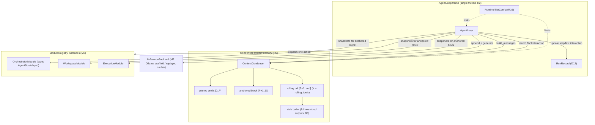
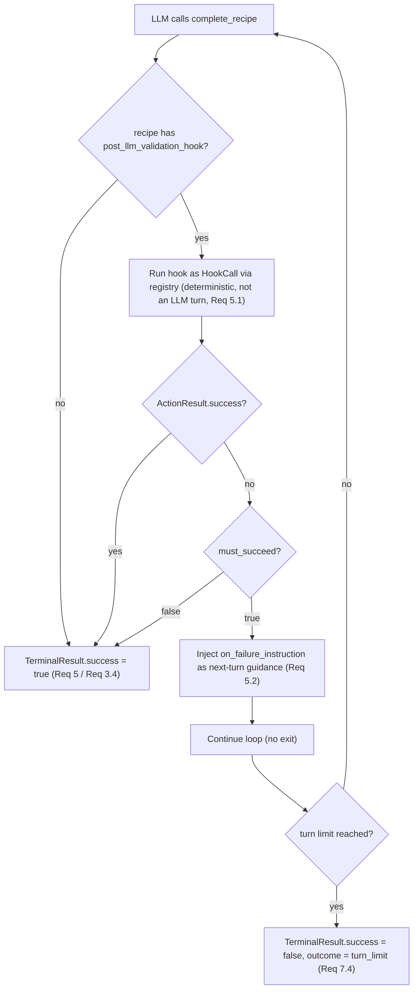

# Design Document

**Spec:** M4 — AgentLoop, ContextCondenser, OrchestratorModule, RuntimeTierConfig
**Workflow:** Requirements-first (feature)

## Overview

M4 is the orchestration milestone: it wires the M1 value types, the M2
inference backend, and the M3 stateful modules into a running agent. The deliverable
is a single-threaded, deterministic loop (`AgentLoop`) that drives an LLM through
one module action per turn until a recipe's deterministic exit gate is satisfied or
the turn limit is hit.

Five new C++ components are introduced, each grounded in an existing M1–M3 contract:

| Component | Satisfies | Role |
|---|---|---|
| `RuntimeTierConfig` | R4 (Req 4), R16 | CPU-first map from `ComputeProfile` to limits + universal flags; the single source of all thresholds. |
| `ContextCondenser` | R2 (Req 2), R6, R8 | Owns the three-segment prompt (pinned prefix / anchored block / rolling tail), eviction, head+tail spill, and the wipe policy. |
| `OrchestratorModule` | R3 (Req 3), R11 | An `IAgentModule` that owns the `AgentScratchpad`, validates required fields before a wipe, and exposes completion as an action. |
| `RunRecord` | R6 (Req 6), D12 | Loop-owned session metadata kept out of `AgentScratchpad`. |
| `AgentLoop` | R1 (Req 1), R5 (Req 5), R14 | The deterministic driver and the recipe exit gate. |

Plus two artifacts that prove the milestone end-to-end:

- **One code recipe cartridge** (`code_smoke_file`) that loads `WorkspaceModule` +
  `ExecutionModule`, exposes the file-authoring actions, and defines a
  `post_llm_validation_hook` (Req 7).
- **A replayed `IInferenceBackend` test double** so the loop runs deterministically
  in CI with no network (Req 8.3).

### Design principles honored

- **R2 — single-threaded, deterministic, value-oriented.** No async, no coroutines.
  Every turn's state is owned by the `AgentLoop` frame or the `ContextCondenser`.
  Given the same recipe, user request, and a replayed backend, two runs produce
  byte-identical transcripts (Req 1.6).
- **R19 — improve, don't transliterate.** One action-call format
  `{thought, module, action, args}` (M1 `ActionCall`) replaces Python's two formats
  and its heal/alias layer; `error_code` (empty iff success, M1 `ActionResult`)
  replaces string-matching on output text (`run_state.py:292`).
- **R20 — condense.** The five C++ components target materially less code than the
  Python they replace (`code_agent.py` ~230, `context_manager.py` ~260,
  `run_state.py` session portion, `context_budget.py` tiers). Accounted in the
  Testing Strategy's R20 note.

### Non-goals (deferred, from requirements)

Real KV checkpoint/rollback and native GBNF are **M5** (`LlamaCppBackend`). On the
M2 Ollama scaffold, `supports_kv_reuse() == false`: the backend resends the full
context each `generate()`, and output is constrained with a JSON schema `format`
(`OutputConstraint::json_schema`) rather than GBNF. M4 reads KV-rollback and GBNF as
universal flags that report *unsupported* today so M5 can flip them without a config
change (Req 4.3).

### Conventions followed (verified against the source tree)

- Everything lives in `namespace aquila`.
- `using Json = nlohmann::ordered_json` (`aquila/json.hpp`); object key order is
  preserved so serialization is byte-stable.
- New value types provide free functions `to_json(Json&, const T&)` and
  `from_json(const Json&, T&, const std::string& path)`, and are round-tripped via
  `to_canonical_string<T>()` / `parse<T>()`.
- Malformed input throws `SchemaError` with a JSON-pointer `path()`.
- Headers live under `src/core/include/aquila/agent/`; sources alongside under
  `src/core/agent/`; both are added to the `aquila_core` static library
  (`src/core/CMakeLists.txt`). Unit tests go in `tests/unit/` (Catch2WithMain) and
  are listed in `tests/unit/CMakeLists.txt`.

## Architecture

### Component layout

New headers under `src/core/include/aquila/agent/`, sources under `src/core/agent/`:

```
src/core/include/aquila/agent/
  runtime_tier.hpp        RuntimeTierConfig, TierLimits, UniversalFlags
  context_condenser.hpp   ContextCondenser, SpillBuffer, condenser segments
  orchestrator_module.hpp OrchestratorModule (IAgentModule / ModuleBase)
  run_record.hpp          RunRecord
  agent_loop.hpp          AgentLoop, LoopConfig, LoopOutcome, TerminalResult, TurnRecord
src/core/agent/
  runtime_tier.cpp
  context_condenser.cpp
  orchestrator_module.cpp
  run_record.cpp
  agent_loop.cpp
```

The code recipe cartridge ships as a JSON resource consumed by the live/unit tests:

```
src/core/agent/recipes/code_smoke_file.recipe.json   (canonical RecipeCartridge JSON)
```

A header-only accessor (`aquila/agent/recipes.hpp`, `code_smoke_file_recipe()`)
returns the parsed `RecipeCartridge` so no file I/O is needed at run time; the JSON
file is the human-readable source of truth and is parity-checked in a unit test.

`OrchestratorModule` is registered as a built-in alongside `WorkspaceModule` and
`ExecutionModule` in `src/core/modules/builtin.cpp` so recipes can load it by id
`"OrchestratorModule"` and `ModuleRegistry::validate_recipe` can see it.

### Ownership and data flow



Key boundaries:

- The condenser owns all prompt memory; the loop owns the frame and `RunRecord`.
- `OrchestratorModule` owns the `AgentScratchpad`; the condenser reads a snapshot of
  it for the anchored block but does not mutate it.
- Only `RuntimeTierConfig` holds thresholds; the loop and condenser read them and
  hardcode nothing (Req 4.4).

### Turn cycle (Req 1, Req 2, Req 5)

```mermaid
sequenceDiagram
    participant L as AgentLoop
    participant C as ContextCondenser
    participant B as IInferenceBackend
    participant R as ModuleRegistry
    participant M as Target module
    participant O as OrchestratorModule

    loop until terminal or turn_limit (Req 1.5)
        L->>C: build_messages() -> vector<Message>
        Note over L,C: pinned prefix + anchored block + rolling tail (Req 2.1)
        L->>B: append(messages), generate(params with OutputConstraint::json_schema) (Req 1.2, R14)
        B-->>L: GenerationResult{content}
        alt parse(content) -> ActionCall fails (Req 1.3)
            L->>C: record parse-failure note + corrective user Message
            Note over L: no throw; continue to next turn
        else valid ActionCall
            L->>R: resolve module + check action is exposed (Req 1.4)
            alt module/action not available
                L->>C: record synthetic failed ToolInteraction (error_code), surface to next turn
            else complete_recipe
                L->>O: execute_action("complete_recipe", args)
                O->>L: request exit gate
                L->>M: run post_llm_validation_hook as HookCall (deterministic, Req 5.1)
                alt hook must_succeed && failed (Req 5.2)
                    L->>C: inject on_failure_instruction, continue
                else hook ok (Req 5.3)
                    L-->>L: TerminalResult{success=true, completion output}
                end
            else ordinary action
                L->>M: execute_action(name, args)
                M-->>L: ActionResult
                L->>C: record_tool_cycle(ToolInteraction) (ring buffer + spill, Req 2.2/2.3)
                L->>L: update RunRecord (step_index, last interaction) (Req 6.2)
                opt condenser.should_condense() (Req 2.6)
                    Note over L,O: wipe only after Orchestrator validates scratchpad (Req 3.2/3.3)
                    L->>C: condense() -> clear tail, refresh anchored block (Req 2.4)
                end
            end
        end
    end
    Note over L: turn limit reached -> TerminalResult{turn_limit, success=false} (Req 1.5)
```

### Completion-gate flow (Req 5)



The hook is validated structurally at **load time**: `ModuleRegistry::validate_recipe`
rejects a hook that names a module not in `load_modules` or an action the module does
not expose for hooks, throwing `SchemaError` at the recipe JSON path (Req 5.4). Because
a `HookCall` is made by the runner, it may target actions outside `expose_actions`
(Req 5.5, M1 `recipe.hpp` comment).

## Components and Interfaces

All signatures are C++ in `namespace aquila`, following the M1–M3 style.

### RuntimeTierConfig (Req 4, R16)

```cpp
// aquila/agent/runtime_tier.hpp
#pragma once
#include "aquila/inference/backend.hpp"   // ComputeProfile
#include <cstddef>
#include <cstdint>

namespace aquila {

// Per-tier numeric knobs (R16, D:L706-734). No thresholds live anywhere else.
struct TierLimits {
    std::uint64_t condense_threshold;  // estimated-token footprint that forces a wipe
    std::size_t   rolling_tools;       // K: tail entries kept (ring-buffer size)
    std::size_t   tool_output_chars;   // head+tail cap before an output spills
    std::uint32_t max_thought_tokens;  // generation cap for the `thought` budget
    std::uint32_t gpu_layers;          // offload hint (0 = CPU only)
    std::uint32_t max_turns = 16;      // turn cap (parity: code_agent.py _max_turns)
};

// Flags that exist regardless of tier so M5 can enable them without a config
// change (Req 4.3). On the M2 Ollama scaffold kv_rollback and gbnf report false.
struct UniversalFlags {
    bool kv_rollback = false;  // real KV checkpoint/rollback (M5)
    bool gbnf = false;         // native grammar-constrained decode (M5)
    bool ngram = false;        // n-gram / draft decoding (M5)
};

class RuntimeTierConfig {
public:
    // CPU-first: the default is a CPU tier; GPU is an explicit boost (Req 4.2).
    static RuntimeTierConfig for_profile(ComputeProfile profile);
    static RuntimeTierConfig default_config() { return for_profile(ComputeProfile::cpu_low_spec_edge); }

    [[nodiscard]] ComputeProfile       profile() const noexcept { return profile_; }
    [[nodiscard]] const TierLimits&    limits() const noexcept { return limits_; }
    [[nodiscard]] const UniversalFlags& flags() const noexcept { return flags_; }

private:
    ComputeProfile profile_;
    TierLimits     limits_;
    UniversalFlags flags_;
};

}  // namespace aquila
```

Concrete values (Req 4.1):

| Profile | condense_threshold | rolling_tools | tool_output_chars | max_thought_tokens | gpu_layers |
|---|---|---|---|---|---|
| `cpu_low_spec_edge` (default) | 2048 | 2 | 1500 | 45 | 0 |
| `cpu_moe_fast` | 2048 | 2 | 1500 | 45 | 0 |
| `gpu_high_vram` | 6144 | 4 | 4500 | 150 | 999 |

The CPU tiers share the conservative edge limits; `gpu_high_vram` is the boost. The
per-profile mapping is the only place these numbers appear, so the loop/condenser
read `limits()` and never hardcode a threshold (Req 4.4).

### ContextCondenser (Req 2, R6, R8)

```cpp
// aquila/agent/context_condenser.hpp
#pragma once
#include "aquila/agent/runtime_tier.hpp"
#include "aquila/types/message.hpp"
#include "aquila/types/scratchpad.hpp"
#include "aquila/types/tool_interaction.hpp"
#include <cstdint>
#include <deque>
#include <string>
#include <unordered_map>
#include <vector>

namespace aquila {

// Full text of a spilled (oversized) tool output, reachable by reference (R8).
struct SpillEntry {
    std::string ref;        // stable handle embedded in the truncated view
    std::string full_text;
};

class ContextCondenser {
public:
    explicit ContextCondenser(TierLimits limits);

    // Pinned prefix [0..P]: system prompt + active recipe schema. Set once; never
    // evicted (Req 2.1). Schema text is the rendered action schema for the recipe.
    void set_pinned_prefix(std::string system_prompt, std::string recipe_schema);

    // Anchored block [P+1..S]: a snapshot of the scratchpad + module state snapshots.
    // Refreshed on wipe; otherwise stable (Req 2.1, 2.4).
    void set_anchored(const AgentScratchpad& scratchpad,
                      const std::vector<std::pair<std::string, Json>>& module_snapshots);

    // Rolling tail [S+1..end]: records one interaction, evicting the oldest when the
    // tail already holds K = limits.rolling_tools entries (Req 2.2). Oversized outputs
    // are stored head+tail-truncated with the full text spilled (Req 2.3).
    void record_tool_cycle(const ToolInteraction& interaction);

    // Appends a corrective/guidance user message to the tail region without a tool
    // cycle (parse-failure recovery and hook on_failure_instruction).
    void push_guidance(std::string text);

    // Assembles the prompt: pinned prefix, then anchored block, then rolling tail,
    // in that order (Req 2.1).
    [[nodiscard]] std::vector<Message> build_messages() const;

    // ceil(chars/4) via estimate_tokens over build_messages(); agrees with Python's
    // estimate_messages_tokens within rounding (Req 2.5).
    [[nodiscard]] std::uint64_t estimate_prompt_tokens() const;

    // True once the assembled footprint reaches limits.condense_threshold (Req 2.6).
    [[nodiscard]] bool should_condense() const;

    // Wipe: pinned prefix unchanged, anchored block refreshed from the latest
    // set_anchored() inputs, rolling tail cleared (Req 2.4). Returns the evicted
    // interactions for the run record / logging.
    void condense();

    // Side-buffer lookup for a spilled output (R8).
    [[nodiscard]] const std::string* resolve_spill(const std::string& ref) const;

private:
    [[nodiscard]] std::string head_tail_truncate(const std::string& text, std::string& out_ref);

    TierLimits limits_;
    std::string system_prompt_;
    std::string recipe_schema_;
    Message anchored_;                         // rendered scratchpad + snapshots
    std::deque<ToolInteraction> tail_;         // ring buffer, cap = rolling_tools
    std::vector<std::string> guidance_;        // pending corrective messages
    std::unordered_map<std::string, std::string> spill_;  // ref -> full_text
    std::uint64_t spill_seq_ = 0;
};

}  // namespace aquila
```

Truncation (R8): when an output exceeds `tool_output_chars`, the condenser keeps a
head and a tail slice joined by a marker that embeds a spill reference (e.g.
`"... [spilled {chars} chars, ref=spill:7] ..."`), stores the full text in `spill_`,
and puts the truncated view in the tail. This diverges from Python's head-only
`truncate_text` (`code_context.py`) to preserve the end of a diagnostic, which is
usually where the error summary lives (R19).

### OrchestratorModule (Req 3, R11)

```cpp
// aquila/agent/orchestrator_module.hpp
#pragma once
#include "aquila/modules/module.hpp"
#include "aquila/types/scratchpad.hpp"
#include <string>
#include <vector>

namespace aquila {

// Meta-module: owns the AgentScratchpad and exposes progress + completion as
// first-class actions (R11). Registered as built-in id "OrchestratorModule".
class OrchestratorModule final : public ModuleBase {
public:
    explicit OrchestratorModule(const ModuleContext& ctx);

    [[nodiscard]] std::string module_id() const override { return "OrchestratorModule"; }
    [[nodiscard]] std::vector<ActionSchema> get_actions() const override;  // checkpoint_notes, trigger_context_condense, complete_recipe (Req 3.1)

    // initial_state: {required_fields?: [..] , checklist?: [..]}. required_fields are
    // the recipe's scratchpad_checklist names that must be non-empty before a wipe.
    void configure(const Json& initial_state) override;

    [[nodiscard]] Json export_state_snapshot() const override;   // scratchpad + checklist, round-trips byte-equal (Req 3.5)
    void restore_state_snapshot(const Json& snapshot) override;

    // Host API (not exposed to the LLM): the loop reads the scratchpad for the
    // anchored block and consults validation/completion intents.
    [[nodiscard]] const AgentScratchpad& scratchpad() const noexcept { return pad_; }
    [[nodiscard]] bool scratchpad_valid() const;     // required_fields present & non-empty
    [[nodiscard]] std::vector<std::string> missing_fields() const;

    // Set by complete_recipe / trigger_context_condense so the loop can act on the
    // intent after execute_action returns (ModuleBase stays side-effect-local).
    enum class Intent { none, condense_requested, completion_requested };
    [[nodiscard]] Intent take_intent();              // reads and clears

protected:
    ActionResult run(const std::string& action_name, const Json& args) override;

private:
    ActionResult checkpoint_notes(const Json& args);          // updates pad_ fields (Req 3.2)
    ActionResult trigger_context_condense(const Json& args);  // validates then requests wipe (Req 3.3)
    ActionResult complete_recipe(const Json& args);           // requests completion gate (Req 3.4)

    ModuleContext ctx_;
    AgentScratchpad pad_;
    std::vector<std::string> required_fields_;
    Intent intent_ = Intent::none;
    std::string completion_output_;
};

}  // namespace aquila
```

Coordination:
- `checkpoint_notes` merges the supplied fields into `pad_` and returns a failed
  `ActionResult{error_code="missing_required_field"}` if a recipe-required field is
  empty (Req 3.2). This is stricter than Python, which does not validate.
- `trigger_context_condense` validates the scratchpad first; only on success does it
  set `Intent::condense_requested`, so the loop performs the wipe **after** notes are
  saved — the agent cannot lose history before saving (Req 3.3).
- `complete_recipe` records `completion_output_` and sets
  `Intent::completion_requested`; the loop runs the exit gate (Req 3.4, Req 5). The
  module does not itself run the hook — the loop owns the registry and the recipe.

### RunRecord (Req 6, D12)

```cpp
// aquila/agent/run_record.hpp
#pragma once
#include "aquila/json.hpp"
#include "aquila/types/tool_interaction.hpp"
#include <cstdint>
#include <optional>
#include <string>

namespace aquila {

// Loop-owned session metadata, deliberately NOT part of AgentScratchpad (D12).
// Fields drawn from Python's TaskRunContext (run_state.py:95-220).
struct RunRecord {
    std::string task_id;
    std::string mode;          // e.g. "code"
    std::string instance_id;
    std::uint64_t step_index = 0;
    Json ground_truth = Json::object();        // free-form acceptance context
    std::optional<ToolInteraction> last_interaction;

    bool operator==(const RunRecord&) const = default;
};

void to_json(Json& j, const RunRecord& v);
void from_json(const Json& j, RunRecord& v, const std::string& path);  // round-trips byte-equal (Req 6.4)

}  // namespace aquila
```

The loop creates one `RunRecord` per run (Req 6.1), updates `step_index` and
`last_interaction` as turns advance (Req 6.2), and never copies these fields into the
scratchpad. Python per-task `run_state.json` files are never imported — a C++ run
starts fresh (Req 6.3).

### AgentLoop (Req 1, Req 5, R14)

```cpp
// aquila/agent/agent_loop.hpp
#pragma once
#include "aquila/agent/context_condenser.hpp"
#include "aquila/agent/orchestrator_module.hpp"
#include "aquila/agent/run_record.hpp"
#include "aquila/agent/runtime_tier.hpp"
#include "aquila/inference/backend.hpp"
#include "aquila/modules/registry.hpp"
#include "aquila/types/recipe.hpp"
#include "aquila/types/tool_interaction.hpp"
#include <string>
#include <vector>

namespace aquila {

// Why the loop stopped.
enum class LoopOutcome { success, turn_limit, aborted };

// One recorded turn; the transcript is the ordered list of these (Req 1.6).
struct TurnRecord {
    std::uint64_t index = 0;
    std::string raw_reply;                 // backend content
    bool parsed = false;                   // false on a parse failure (Req 1.3)
    std::optional<ActionCall> call;
    std::optional<ToolInteraction> interaction;
    std::string note;                      // corrective/guidance text, if any

    bool operator==(const TurnRecord&) const = default;
};

// Terminal result of a run (Req 1.5, 5.3, 7.4).
struct TerminalResult {
    LoopOutcome outcome = LoopOutcome::turn_limit;
    bool success = false;                  // true only on a passed exit gate
    std::string completion_output;         // from complete_recipe when success
    std::vector<TurnRecord> transcript;    // byte-identical across identical runs
    RunRecord run_record;
};

struct LoopConfig {
    RuntimeTierConfig tier = RuntimeTierConfig::default_config();  // CPU-first (Req 4.2)
    std::string system_prompt;
    std::string task_id;
    std::string mode;
    std::string instance_id;
    Json ground_truth = Json::object();
};

class AgentLoop {
public:
    AgentLoop(IInferenceBackend& backend, const ModuleRegistry& registry, ModuleContext module_ctx);

    // Loads+validates the recipe (SchemaError at load time, Req 5.4), builds the
    // module set, seeds the condenser, then runs turns until terminal or turn limit.
    TerminalResult run(const RecipeCartridge& recipe, const std::string& user_request,
                       const LoopConfig& config);

private:
    GenerationParams generation_params(const TierLimits& limits) const;  // OutputConstraint::json_schema (R14)
    [[nodiscard]] static Json action_call_schema();                      // {thought, module, action, args}
    TerminalResult run_exit_gate(const RecipeCartridge& recipe, std::string completion_output);
    void dispatch_and_record(/* module, action, args */);                // one action per turn (Req 1.2)

    IInferenceBackend& backend_;
    const ModuleRegistry& registry_;
    ModuleContext module_ctx_;
};

}  // namespace aquila
```

Turn algorithm (Req 1.2):
1. `messages = condenser.build_messages()`; append to the backend. Because the Ollama
   scaffold has `supports_kv_reuse() == false`, the loop rebuilds and resends the full
   context each turn via `rollback_to(0)` + append — correct, just not reused (M2).
2. `generate(params, nullptr)` with `params.constraint =
   OutputConstraint::json_schema(action_call_schema())` and
   `params.max_tokens = limits.max_thought_tokens`-derived budget (R14).
3. `parse<ActionCall>(result.content)` inside a try/catch. On `SchemaError`, record a
   `TurnRecord{parsed=false}`, `condenser.push_guidance(corrective)`, continue — no
   throw (Req 1.3).
4. Resolve `module`/`action`. If the module is unknown, not loaded by the recipe, or
   the action is not exposed, build a synthetic failed `ActionResult` with the right
   `error_code` (`unknown_module`, `action_not_exposed`) and surface it; never inspect
   `llm_facing_output` text (Req 1.4, R19).
5. Dispatch exactly one `execute_action`; wrap as a `ToolInteraction`;
   `condenser.record_tool_cycle(...)`; update `RunRecord` (Req 1.2, 6.2).
6. Handle Orchestrator intents: a condense request triggers `condenser.condense()`
   after validation; a completion request runs the exit gate (Req 5).
7. `if (condenser.should_condense())` wipe (after scratchpad validation) (Req 2.6).
8. Stop at `limits.max_turns` with `TerminalResult{outcome=turn_limit, success=false}`
   (Req 1.5).

### Code recipe cartridge (Req 7, R12)

`code_smoke_file.recipe.json` (canonical `RecipeCartridge`):
- `load_modules`: `WorkspaceModule`, `ExecutionModule`, `OrchestratorModule`.
- `expose_actions`: `WorkspaceModule` → `create_file`, `surgical_edit`;
  `OrchestratorModule` → `checkpoint_notes`, `complete_recipe`.
- `scratchpad_checklist`: the required fields the Orchestrator enforces.
- `post_llm_validation_hook`: `{module: "ExecutionModule", action:
  "exec_sandboxed_cmd", must_succeed: true, on_failure_instruction: "..."}` — or a
  dedicated read-back via `WorkspaceModule` — that checks a file matching
  `**/harness_smoke.py` exists and contains `HARNESS_OK` (Req 7.2, parity
  `capability_harness.py` `code_smoke_file`). The hook action may be outside
  `expose_actions` because it is a runner `HookCall` (Req 5.5).

Every write stays inside the workspace root through the M3 `PathFirewall` carried by
`ModuleContext.workspace_root` (Req 7.5).

### Replayed inference backend (Req 8.3)

```cpp
// tests/unit/replay_backend.hpp (test-only)
class ReplayBackend final : public IInferenceBackend {
public:
    explicit ReplayBackend(std::vector<GenerationResult> scripted,
                           ComputeProfile profile = ComputeProfile::cpu_low_spec_edge);
    void append(const Message&) override;             // records context for assertions
    std::size_t mark_checkpoint() const override;
    void rollback_to(std::size_t) override;
    GenerationResult generate(const GenerationParams&, const TokenCallback&) override;  // pops next scripted reply
    ComputeProfile active_profile() const noexcept override;
    bool supports_kv_reuse() const noexcept override { return false; }  // matches Ollama scaffold
};
```

Scripted replies let loop logic run deterministically with no network, so CI exercises
the full turn cycle (Req 8.3). It mirrors the Ollama scaffold's `supports_kv_reuse() ==
false`.

## Data Models

### New value types (canonical JSON, M1 convention)

**RunRecord** (Req 6)
```json
{
  "task_id": "code_smoke_file#1",
  "mode": "code",
  "instance_id": "run-0001",
  "step_index": 3,
  "ground_truth": { "glob": "**/harness_smoke.py", "contains": "HARNESS_OK" },
  "last_interaction": { "id": "...", "module": "WorkspaceModule", "action": "create_file", "args": {}, "result": {} }
}
```
`last_interaction` reuses the M1 `ToolInteraction` serializer. The whole record
round-trips byte-equal via `to_canonical_string<RunRecord>()` / `parse<RunRecord>()`
(Req 6.4).

**Action-call schema** (the `OutputConstraint::json_schema`, R14) — the JSON Schema
the backend enforces, matching M1 `ActionCall`:
```json
{
  "type": "object",
  "properties": {
    "thought":  { "type": "string" },
    "module":   { "type": "string" },
    "action":   { "type": "string" },
    "args":     { "type": "object" }
  },
  "required": ["thought", "module", "action", "args"],
  "additionalProperties": false
}
```

### Reused M1/M2/M3 types (unchanged)

- `Message{Role, content, images}`, `Role` enum — condenser output.
- `ActionCall{thought, module, action, args}` — parsed LLM decision.
- `ActionResult{success, error_code, llm_facing_output, token_estimate}` — dispatch
  outcome; `error_code` empty iff success drives all loop branching (R19).
- `ToolInteraction{id, module, action, args, result}` — rolling-tail element and
  `RunRecord.last_interaction`.
- `AgentScratchpad` + `ChecklistItem`/`ChecklistStatus` — owned by OrchestratorModule.
- `RecipeCartridge` + `ModuleLoad`/`HookCall`/`ValidationHook` — loaded and validated.
- `GenerationParams`/`GenerationResult`/`OutputConstraint`/`ComputeProfile` — backend.
- `ModuleContext`, `IAgentModule`/`ModuleBase`, `ModuleRegistry`, `estimate_tokens` — M3.

### Condenser internal state

- `system_prompt_` + `recipe_schema_` → pinned prefix (one or two `system` messages).
- `anchored_` → one `system` message rendering the scratchpad + module snapshots.
- `tail_` → `std::deque<ToolInteraction>` capped at `rolling_tools`; each becomes a
  `user`/`tool` message pair in `build_messages()`.
- `spill_` → `ref -> full_text` for oversized outputs (R8).

### Tier limits table

See the `RuntimeTierConfig` table above — the authoritative `{condense_threshold,
rolling_tools, tool_output_chars, max_thought_tokens, gpu_layers, max_turns}` per
`ComputeProfile`, plus `UniversalFlags{kv_rollback, gbnf, ngram}` (all false on the
scaffold).

## Correctness Properties

*A property is a characteristic or behavior that should hold true across all valid
executions of a system — essentially, a formal statement about what the system should
do. Properties serve as the bridge between human-readable specifications and
machine-verifiable correctness guarantees.*

These properties are derived from the prework analysis of the acceptance criteria.
Criteria classified EXAMPLE / SMOKE / INTEGRATION (fixed structural checks, parity
oracles, build gates, and the live `code_smoke_file` run) are covered by the Testing
Strategy rather than as universally quantified properties. Each property below is
implemented by a single property-based test (minimum 100 iterations) using a C++ PBT
library, driven by a `ReplayBackend` and modules over a temp workspace so runs are
deterministic and CI-safe.

### Property 1: One action dispatched per valid turn

*For any* scripted sequence of valid `ActionCall` replies, each turn the loop executes
exactly one module `execute_action` and appends exactly one `ToolInteraction` to the
transcript and the rolling tail.

**Validates: Requirements 1.2**

### Property 2: Parse failures never throw and always advance a turn

*For any* backend reply string that fails `parse<ActionCall>`, `AgentLoop::run` does
not throw; it records a `TurnRecord` with `parsed == false`, appends a corrective
guidance message, and advances exactly one turn.

**Validates: Requirements 1.3**

### Property 3: Outcome classification is error_code-driven only

*For any* dispatch that fails (unknown module, action not exposed, or a failed
`ActionResult`), the recorded result's `error_code` is non-empty and the loop's
control flow depends only on `success` / `error_code`, never on the text of
`llm_facing_output`.

**Validates: Requirements 1.4**

### Property 4: Turn limit terminates as non-success

*For any* tier `max_turns` N and any replayed backend that never completes the recipe,
the loop stops after exactly N turns and returns
`TerminalResult{outcome == turn_limit, success == false}`.

**Validates: Requirements 1.5**

### Property 5: Determinism — identical inputs yield byte-identical transcripts

*For any* recipe, user request, and replay script, two independent runs produce
byte-identical transcripts and run records (compared via canonical serialization).

**Validates: Requirements 1.6**

### Property 6: Segment ordering

*For any* condenser state, `build_messages()` emits the pinned prefix first, then the
anchored block, then the rolling-tail entries in recorded order; the pinned-prefix
messages equal the system prompt and recipe schema that were set.

**Validates: Requirements 2.1**

### Property 7: Rolling tail holds exactly the last K interactions

*For any* tier `rolling_tools` K and any sequence of M recorded interactions, after
recording the tail contains exactly the last `min(M, K)` interactions in order and its
size never exceeds K.

**Validates: Requirements 2.2**

### Property 8: Oversized outputs truncate with a recoverable spill

*For any* tool output: if its length exceeds `tool_output_chars`, the stored tail view
is bounded in size, embeds a spill reference, and `resolve_spill(ref)` returns the
original full text; otherwise the output is stored verbatim with no spill.

**Validates: Requirements 2.3**

### Property 9: Wipe preserves the prefix, refreshes the anchor, clears the tail

*For any* condenser state, after `condense()` the pinned-prefix messages are
unchanged, the anchored block equals the rendering of the most recent scratchpad and
module snapshots, and the rolling tail is empty.

**Validates: Requirements 2.4**

### Property 10: Condense threshold is a monotone boundary

*For any* condenser state, `should_condense()` is true exactly when
`estimate_prompt_tokens()` is greater than or equal to the tier's
`condense_threshold`.

**Validates: Requirements 2.6**

### Property 11: Checkpoint validates required fields and merges on success

*For any* set of required fields and any `checkpoint_notes` args, the call succeeds
exactly when every required field is present and non-empty; on success the scratchpad
reflects the provided updates, and on failure it returns
`error_code == "missing_required_field"` and leaves the required-field state
unchanged.

**Validates: Requirements 3.2**

### Property 12: Condense is requested only after scratchpad validation

*For any* scratchpad state, `trigger_context_condense` yields a
`condense_requested` intent exactly when the scratchpad passes required-field
validation; otherwise it returns a failed `ActionResult` and produces no intent.

**Validates: Requirements 3.3**

### Property 13: Scratchpad snapshot round-trip

*For any* scratchpad and checklist, exporting the snapshot, restoring it into a fresh
`OrchestratorModule`, and exporting again yields byte-identical JSON.

**Validates: Requirements 3.5**

### Property 14: Behavior follows tier limits, not hardcoded constants

*For any* two tiers that differ in `rolling_tools` or `condense_threshold`, the
condenser's tail cap and `should_condense()` boundary change to match the selected
tier's values.

**Validates: Requirements 4.4**

### Property 15: The exit gate is a deterministic module call, not an LLM turn

*For any* recipe with a `post_llm_validation_hook`, attempting `complete_recipe`
invokes the hook's module/action exactly once through the registry without issuing any
backend generation during the gate.

**Validates: Requirements 5.1**

### Property 16: Completion succeeds exactly when the gate passes

*For any* recipe, a completion attempt returns `TerminalResult{success == true}` with
the completion output exactly when the hook is absent or returns a successful
`ActionResult`; when `must_succeed` is true and the hook fails, the loop does not exit
and injects `on_failure_instruction` as the next turn's guidance.

**Validates: Requirements 5.2, 5.3**

### Property 17: Invalid hook references fail at load time

*For any* recipe whose `post_llm_validation_hook` names a module not in
`load_modules` or an action no loaded module exposes for hooks, loading the recipe
throws `SchemaError` with a non-empty JSON-pointer path; a structurally valid recipe
does not throw.

**Validates: Requirements 5.4**

### Property 18: Hooks may invoke actions the LLM cannot

*For any* action present on a loaded module but absent from its `expose_actions`, a
`HookCall` invokes it successfully, while an LLM-driven dispatch of the same action is
rejected with `error_code == "action_not_exposed"`.

**Validates: Requirements 5.5**

### Property 19: Session fields advance in the run record and never leak into memory

*For any* scripted run, after each turn the run record's `step_index` increments and
`last_interaction` updates, and none of the run-record session fields appear in the
`AgentScratchpad`.

**Validates: Requirements 6.2**

### Property 20: Run record round-trip

*For any* `RunRecord`, `parse<RunRecord>(to_canonical_string(r))` equals `r` and
re-serialization is byte-identical.

**Validates: Requirements 6.4**

### Property 21: A permanently failing gate never reports success

*For any* forced-failure scenario in which the validation hook can never pass, the loop
never returns a success terminal and ends with
`TerminalResult{outcome == turn_limit, success == false}`.

**Validates: Requirements 7.4**

## Error Handling

The design uses two distinct, deliberately separated error channels, both already
established in M1–M3 (R19).

### Load-time: structural errors throw `SchemaError`

- Recipe loading runs `ModuleRegistry::validate_recipe` before the first turn.
  Unknown modules, unexposed/unknown exposed actions, hook references to modules not in
  `load_modules` or actions not present, and `initial_state` that fails `configure`
  all throw `SchemaError` with the offending JSON-pointer `path()` (Req 5.4).
- Malformed `RunRecord` / recipe / snapshot JSON throws `SchemaError` from the
  `from_json(..., path)` functions.
- These are programmer/author errors surfaced before any model turn; the loop does not
  start a run with an invalid recipe.

### Run-time: model and dispatch failures are `error_code`, never exceptions

- A reply that fails to parse is caught; the loop records `parsed == false`, pushes a
  corrective user message, and continues (Req 1.3). No exception escapes `run()`.
- Unknown module / action-not-exposed / failed module action are surfaced as a
  `ToolInteraction` whose `ActionResult.error_code` is non-empty (`unknown_module`,
  `action_not_exposed`, or the module's own code such as `invalid_args`). The loop
  branches solely on `success` / `error_code` and never substring-matches
  `llm_facing_output` (Req 1.4, R19; contrast `run_state.py:292`).
- `OrchestratorModule::checkpoint_notes` returns
  `fail("missing_required_field", ...)` when a recipe-required field is empty (Req 3.2).
- A backend `GenerationResult{ok == false}` (timeout, transport error, etc.) is
  treated as a failed turn: the loop records the backend `error_code`, pushes guidance,
  and continues up to the turn limit; it never throws.

### The exit gate never fabricates success

- `complete_recipe` only *requests* completion; success is granted solely by a passing
  deterministic hook (or an absent hook). A failing `must_succeed` hook keeps the loop
  running (Req 5.2), and exhausting the turn limit returns a non-success terminal
  (Req 1.5, 7.4) — the loop cannot assert "done" that the hook did not prove.

## Testing Strategy

The strategy combines property-based tests (universal loop/condenser/record
invariants), example and structural unit tests, Python oracle-fixture parity, and
live end-to-end acceptance. All CI tests are network-free via the `ReplayBackend`
(Req 8.3).

### Dual approach

- **Property tests** verify the 21 properties above across generated inputs.
- **Unit (example/structural) tests** cover the fixed-shape criteria: loop is
  synchronous (1.1), Orchestrator exposes exactly the three actions with object schemas
  (3.1), tier value table (4.1), CPU-first default and explicit GPU boost (4.2),
  universal flags present and false on the scaffold (4.3), `complete_recipe` intent
  (3.4), run-record field population (6.1), fresh-start / no `run_state.json` import
  (6.3), and cartridge structure + `validate_recipe` pass (7.1).

### Property-based testing

- **Library:** adopt a header-only C++ PBT library compatible with Catch2 (e.g.
  RapidCheck's Catch integration). Do not hand-roll a generator framework.
- **Config:** each property test runs a minimum of 100 iterations.
- **Tagging:** each test carries a comment in the form
  `// Feature: m4-agent-loop, Property {N}: {property_text}`.
- **Generators:** `ActionCall` sequences (valid and malformed replies), scratchpads and
  checklists, tool outputs around the `tool_output_chars` boundary, tiers, recipes with
  present/absent/failing hooks, and `RunRecord` values. Modules run against a per-case
  temp workspace (`tests/unit/temp_dir.hpp`) so `PathFirewall` is real.
- **Mapping:** Property 1 → turn dispatch count; 2 → parse-failure recovery; 3 →
  error-code branching; 4 → turn-limit termination; 5 → determinism (byte-equal
  transcripts); 6–10 → condenser segments/ring-buffer/spill/wipe/threshold; 11–13 →
  Orchestrator validation/condense-gating/snapshot; 14 → tier-driven behavior; 15–18 →
  exit-gate mechanism/outcome/load-validation/hook-bypass; 19–20 → run record; 21 →
  forced-failure non-success.

### Python oracle fixtures (Req 8.2, 2.5)

- The token estimate and tail-keep behavior are parity-checked against fixtures
  generated from the pinned Python checkout (`759212a`) by extending
  `tests/fixtures/python/gen_python_fixtures.py`:
  - `estimate_messages_tokens` → fixture message lists under
    `tests/fixtures/python/` with prefix `messages_estimate_` (file-name-prefix
    convention from `fixtures.hpp`); the C++ test asserts
    `estimate_prompt_tokens` / `estimate_tokens` agrees within rounding (Req 2.5).
  - `_keep_recent_turns` → fixtures verifying the ring-buffer keeps the same last-K
    set as Python for matching K.
- Fixtures are regenerable; `python tests/fixtures/python/gen_python_fixtures.py` must
  leave `git status` clean. The oracle comparison lives in
  `tests/unit/python_oracle_test.cpp` alongside the existing M3 oracle cases.

### Unit test files (new, in `tests/unit/`, added to `tests/unit/CMakeLists.txt`)

- `runtime_tier_test.cpp` — tier table, CPU-first default, universal flags (Req 4).
- `context_condenser_test.cpp` — segments, ring buffer, spill, wipe, threshold,
  tier-driven behavior; oracle hooks for token estimate (Req 2).
- `orchestrator_module_test.cpp` — action set, field validation, condense gating,
  snapshot round-trip (Req 3).
- `run_record_test.cpp` — field population, round-trip, scratchpad separation (Req 6).
- `agent_loop_test.cpp` — turn cycle, parse recovery, error-code surfacing, turn limit,
  determinism, exit gate success/refusal, forced-failure non-success (Req 1, 5, 7.4),
  using `replay_backend.hpp`.
- `recipe_cartridge_test.cpp` — load + `validate_recipe` of `code_smoke_file`, and
  load-time `SchemaError` for a bad hook reference (Req 5.4, 7.1).
- `replay_backend.hpp` — the scripted `IInferenceBackend` test double (Req 8.3).

### Live tests (Req 8.4, not in CI)

Under `tests/live/` (excluded from CI, same policy as the M2 Ollama live test):
- `code_smoke_file` end-to-end against stock Ollama, run 3 times, asserting a file
  matching `**/harness_smoke.py` exists and contains `HARNESS_OK` (Req 7.2, 7.3);
  record the turn count and acceptance result.
- Forced-failure live run (fault-injection build that omits `HARNESS_OK`): assert the
  loop reaches the turn limit with a non-success terminal (Req 7.4); the CI-safe
  deterministic counterpart is Property 21 via the replay backend.

### Build lanes and sanitizers (Req 8.5)

All five lanes (`msvc-release`, `msvc-asan`, `msvc-release-cuda`, `mingw-san`,
`linux-san`) and the three CI jobs must pass on a fresh clone, with ASan/UBSan/LSan
reporting nothing. New sources are added to the `aquila_core` library and new tests to
the unit target so every lane builds them.

### R20 line-count accounting (Req 8.6)

M4 replaces, in behavior (not transliteration, R19):

| Python source | Approx. LOC | C++ replacement |
|---|---|---|
| `code_agent.py` `run_tool_session` loop | ~230 | `agent_loop.{hpp,cpp}` |
| `context_manager.py` | ~260 | `context_condenser.{hpp,cpp}` |
| `run_state.py` (session portion) | — | `run_record.{hpp,cpp}` + `orchestrator_module.{hpp,cpp}` |
| `context_budget.py` tiers | — | `runtime_tier.{hpp,cpp}` |

The actual C++ LOC added is measured when the components land and recorded in the
RECON_MAP section 8.4 M4 row, with per-feature verdicts against Python. If the C++ is
not smaller than the Python it replaces, the M4 row must state why (R20). The leverage
here is concrete: one action-call format removes Python's heal/alias layer
(`code_agent.py:41-113`), and `error_code` branching removes the string-matching
classification scattered through `run_state.py`.

---

## Requirements coverage map

| Design section | Requirements satisfied |
|---|---|
| Overview, principles, non-goals | Intro, R2, R19, R20, non-goals |
| Architecture — component layout | All (placement for Req 1–7) |
| Architecture — ownership/data flow | 1.1, 2.1, 4.4, 6.2 |
| Architecture — turn cycle diagram | 1.2, 1.3, 1.4, 2.2, 2.3, 2.6, 5.x |
| Architecture — completion-gate diagram | 5.1, 5.2, 5.3, 5.4, 7.4, 3.4 |
| `RuntimeTierConfig` | 4.1, 4.2, 4.3, 4.4 |
| `ContextCondenser` | 2.1, 2.2, 2.3, 2.4, 2.5, 2.6 |
| `OrchestratorModule` | 3.1, 3.2, 3.3, 3.4, 3.5 |
| `RunRecord` | 6.1, 6.2, 6.3, 6.4 |
| `AgentLoop` | 1.1–1.6, 5.1, 5.2, 5.3 |
| Code recipe cartridge | 7.1, 7.2, 7.5, 5.5 |
| Replayed backend | 8.3 |
| Data Models | M1 parity, 6.4, R14 schema |
| Correctness Properties | 1.2–1.6, 2.1–2.4, 2.6, 3.2, 3.3, 3.5, 4.4, 5.1–5.5, 6.2, 6.4, 7.4 |
| Error Handling | 1.3, 1.4, 3.2, 5.2, 5.4 |
| Testing Strategy | 8.1, 8.2, 8.3, 8.4, 8.5, 8.6, 2.5, 7.2, 7.3 |
