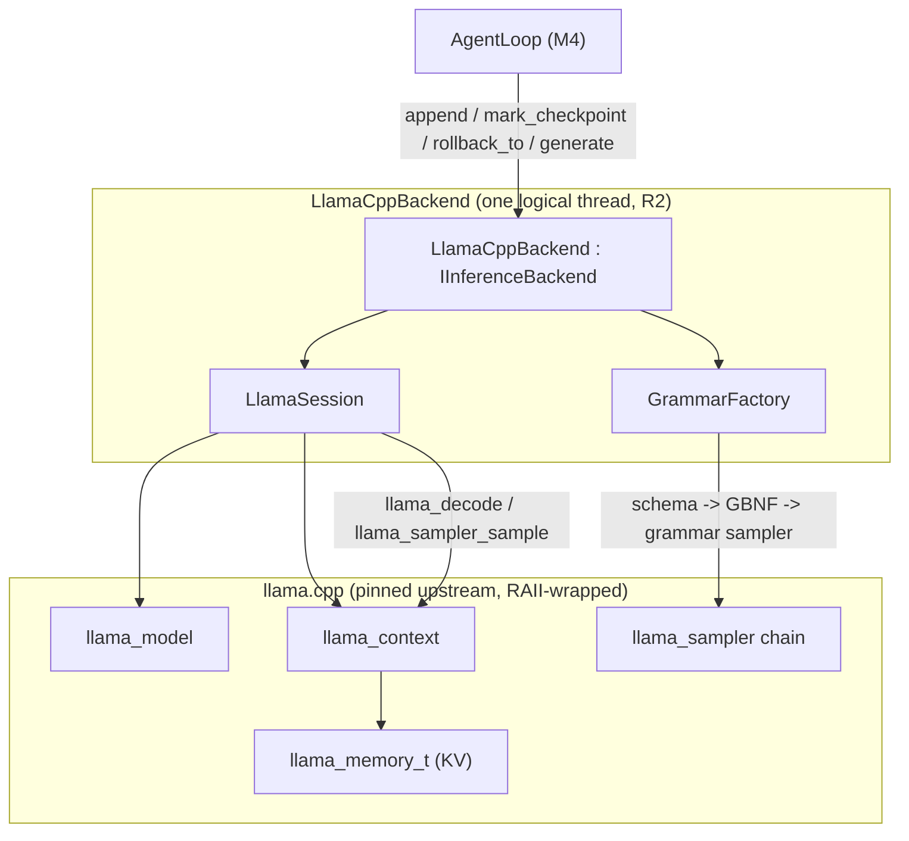
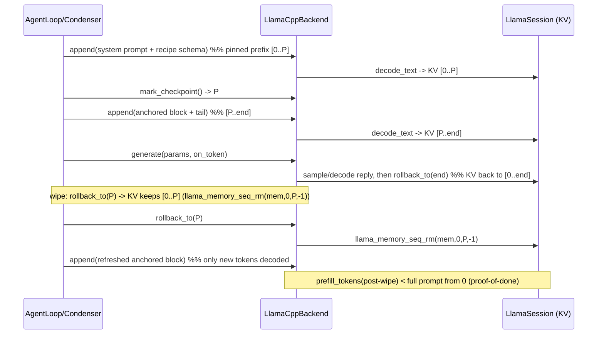

# Design Document

**Spec:** M5 — LlamaCppBackend (direct KV-aware inference, GBNF)
**Workflow:** Requirements-first (feature)

## Overview

M5 adds a second `IInferenceBackend` implementation, `LlamaCppBackend`, linked
directly against the llama.cpp C API. It is the first time the KV-aware interface
designed in M2 is backed by a real KV cache: `mark_checkpoint` / `rollback_to` map
onto llama.cpp sequence memory (`llama_memory_seq_rm`), so a context wipe keeps the
pinned prefix's KV and re-decodes only the new tokens (R6). It is also the first
time the action-call JSON schema is enforced by a grammar: the M2
`OutputConstraint::json_schema` is compiled to GBNF (`json_schema_to_grammar`) and
applied through a grammar sampler (`llama_sampler_init_grammar`), so malformed JSON
is physically impossible (R14).

The M2 `OllamaHttpBackend` stays. M5 is additive: `AgentLoop` (M4) can be
constructed with either backend, and the Ollama backend remains the parity
cross-check. The two universal flags M4 carries as "unsupported today"
(`UniversalFlags.kv_rollback`, `UniversalFlags.gbnf`) flip to true for this backend
with no config-shape change, exactly as M4 intended.

| Component | Satisfies | Role |
|---|---|---|
| llama.cpp (pinned upstream) | R3 (Req 1), D4 | Fetched + built native dependency; CUDA on MSVC (H12). |
| RAII handle wrappers | R1 (Req 2) | `unique_ptr` + deleters around `llama_model` / `llama_context` / `llama_sampler` / `llama_batch`. |
| `LlamaSession` | R2/R6 (Req 3), R15 | Owns model+context+KV; tokenizes, decodes, and implements checkpoint/rollback. |
| `GrammarFactory` | R7/R14 (Req 4) | Schema -> GBNF -> grammar sampler; caches by schema. |
| `LlamaCppBackend` | R15 (Req 2-6) | The `IInferenceBackend`: `append` / `mark_checkpoint` / `rollback_to` / `generate`. |
| Build strategy | R4 (Req 7), H12 | Per-lane: CUDA on MSVC, CPU-only or compiled-out on sanitizer lanes. |
| `ContextStrategy` + bake-off | D14 (Req 9) | Three context-management strategies (KV-rollback/EoCC/SAC) behind one kept interface; task-suite harness decides the M6 condenser on real Qwen 3.5. |

### Design principles honored

- **R1 — zero raw owning pointers.** Every llama.cpp handle is wrapped in a
  `std::unique_ptr<T, Deleter>` (or a small owning class), freed deterministically;
  the sanitizer lanes that build the backend prove no leaks.
- **R2 — single-threaded core.** The backend's public API is synchronous. llama.cpp
  spawns its own compute threads internally (the parallelism S1/R17 permit); the
  Aquila core stays one logical thread.
- **R6 — prefix pinning is real (model-class caveat).** On a plain-RoPE model a wipe
  is `llama_memory_seq_rm(mem, seq, P, -1)` and the post-wipe prefill is strictly
  smaller than from token 0 (Req 5, proven on a small CPU model, Property 8). On
  Qwen 3.5 (recurrent/M-RoPE) a mid-sequence wipe is UNSUPPORTED (Req 3.6, GPU
  finding); the equivalent savings come from a full reset + value-managed re-decode,
  whose strategy is chosen by the Req 9 bake-off and consumed by M6.
- **R14 — grammar, not heal.** GBNF makes the action call well-formed by
  construction; the Python heal/alias layer (H9) has no analogue here.
- **R15 — direct C API.** No HTTP per turn; the backend holds the model and context
  in-process for the life of the run.
- **R19 — improve, don't transliterate.** Where Python's `OllamaClient` returns
  errors as model content and relies on JSON mode + heal, M5 returns typed
  `GenerationResult` errors and makes invalid output impossible.

### Non-goals (deferred, from requirements)

- **R17 CPU-engine tuning** (repacked quants, BLAS prefill, P-core pinning, n-gram
  prompt-lookup speculation) is recorded as deferred. The backend is structured so
  these slot in later (`UniversalFlags.ngram` already exists; the sampler chain and
  decode loop have the seams). M5 requires only KV reuse + GBNF.
- **Draft-model speculative decoding**, KnowledgeModule (M6), domain modules (M7),
  GUI/remote (M8-M10).
- M5 does not remove the Ollama backend or change M1-M4 value types.

### Conventions followed (verified against the source tree)

- `namespace aquila`; `using Json = nlohmann::ordered_json` (`aquila/json.hpp`).
- Headers under `src/core/include/aquila/inference/`, sources under
  `src/core/inference/`, added to `aquila_core` (`src/core/CMakeLists.txt`) behind
  the build option in Requirement 7 so sanitizer lanes stay green.
- Reuses the M2 value types unchanged (`GenerationParams`, `GenerationResult`,
  `OutputConstraint`, `ComputeProfile`, `TokenCallback`, `Message`).
- Typed failures use the existing `GenerationResult{ok=false, error_code, ...}`
  vocabulary; construction-time failures (bad model) throw.
- Unit tests in `tests/unit/` (Catch2WithMain, fast, small/vocab-only GGUF);
  GPU/full-model tests in `tests/live/` (opt-in `-DAQUILA_LIVE_TESTS=ON`, out of CI).

## Architecture

### Component layout

```
src/core/include/aquila/inference/
  llama_backend.hpp     LlamaCppBackend, LlamaConfig
  llama_session.hpp     LlamaSession (model+context+KV), RAII handle wrappers
  grammar.hpp           GrammarFactory (schema -> GBNF -> llama_sampler)
src/core/inference/
  llama_backend.cpp
  llama_session.cpp
  grammar.cpp
cmake/
  AquilaLlamaCpp.cmake  fetch + build llama.cpp per lane (Req 1, 7)
```

### Build strategy (Req 1, Req 7, H12) — the central design decision

llama.cpp is unlike every prior dependency: it ships its own CMake build, a CUDA
backend, and is large. Two facts force the strategy:

1. **CUDA needs the MSVC host compiler (H12).** The llama.cpp CUDA backend builds
   under cl.exe + nvcc, never llvm-mingw clang. So only the MSVC lanes get the GPU.
2. **`AquilaSanitizers.cmake` applies `-fsanitize=...` globally** to fetched deps.
   Building all of llama.cpp (plus, in the GPU case, CUDA) under ASan/UBSan is both
   impractical and not what we are testing — we are testing *our* wrapper, not
   llama.cpp's internals.

Therefore M5 introduces a build option `AQUILA_LLAMACPP` (default ON) and a profile:

| Lane | llama.cpp build | `LlamaCppBackend` | Backend tests |
|---|---|---|---|
| `msvc-release` | CPU (+optionally CUDA) | built | unit (small GGUF) |
| `msvc-release-cuda` | CUDA (cl+nvcc, sm_89) | built | unit + opt-in GPU/live |
| `msvc-asan` | **not built** (`AQUILA_LLAMACPP=OFF`) or CPU no-instrument | compiled out / CPU | skipped or CPU-only |
| `mingw-san` | **not built** (clang can't do CUDA; heavy under ASan) | compiled out | skipped |
| `linux-san` | CPU, **sanitizers suppressed on llama.cpp targets** | built CPU-only | unit (small GGUF) under ASan/UBSan/LSan |

- When `AQUILA_LLAMACPP=OFF`, `llama_backend.cpp` compiles to a stub that is not
  registered and whose tests are guarded out (`#if AQUILA_HAS_LLAMACPP`), the same
  way the live tests are excluded from CI. All five lanes still configure+build+pass.
- On lanes that DO build it, llama.cpp is fetched by `AquilaLlamaCpp.cmake` and its
  own targets are compiled **without Aquila's sanitizer/warning flags** (SYSTEM
  includes; per-target flag scoping like `AquilaTreeSitter.cmake` does, extended to
  turn OFF `-fsanitize` on the upstream targets). Our thin wrapper
  (`llama_session.cpp` etc.) IS instrumented, so the sanitizer still covers the code
  M5 actually writes.
- `linux-san` is the lane that proves the wrapper is leak/UB clean against a real
  (CPU, small-model) llama.cpp. That is the honest sanitizer coverage; the GPU path
  is verified by the opt-in CUDA/live tests, not by a sanitizer.

**Qwen 3.5 load check (Req 1.4, D4):** the first task builds pinned upstream and
attempts to load `Qwen3.5-9B-Q4_K_M.gguf`. The result (loads clean / needs the
fork's `qwen35.cpp` + loader patches) is recorded in RECON_MAP; if patches are
needed, the resolution (upstream commit that already includes Qwen 3.5, or a
documented patch application) is decided then, not assumed here.

### Ownership and data flow



The whole backend is owned on the loop's single thread. `append` tokenizes and
decodes into the KV cache (advancing position); `mark_checkpoint` reads the current
position; `rollback_to` trims the KV; `generate` builds a per-call sampler chain
(including the grammar sampler when a schema is set), runs the token loop, and
returns the reply **without** mutating the KV (the caller appends it to keep it).

## Components and Interfaces

All signatures are C++ in `namespace aquila`. Headers are only compiled when `AQUILA_LLAMACPP` is ON (Req 7); lanes that stub the backend never include the llama.cpp headers.

### RAII handle wrappers (Req 2, R1)

```cpp
// aquila/inference/llama_session.hpp
struct LlamaModelDeleter { void operator()(llama_model* m) const noexcept { llama_model_free(m); } };
struct LlamaCtxDeleter   { void operator()(llama_context* c) const noexcept { llama_free(c); } };
struct LlamaSamplerDeleter { void operator()(llama_sampler* s) const noexcept { llama_sampler_free(s); } };
using ModelPtr   = std::unique_ptr<llama_model, LlamaModelDeleter>;
using ContextPtr = std::unique_ptr<llama_context, LlamaCtxDeleter>;
using SamplerPtr = std::unique_ptr<llama_sampler, LlamaSamplerDeleter>;
// llama_batch is a value type freed with llama_batch_free -> a small owning wrapper.
```

`llama_backend_init()` is called once (a process-lifetime guard); `llama_backend_free()`
at shutdown. These headers are only included in TUs compiled when `AQUILA_LLAMACPP`
is ON, so lanes that stub the backend never see the llama.cpp headers.

### LlamaSession (Req 3, Req 5)

Owns the model, context, and the logical KV position. One sequence (`seq_id = 0`)
is used; the three R6 segments are just position ranges within it.

```cpp
// aquila/inference/llama_session.hpp
class LlamaSession {
public:
    LlamaSession(const std::string& model_path, const LlamaConfig& cfg);  // loads model, creates context

    // Tokenize `text` with role framing and decode it, advancing the KV position.
    // Returns the number of tokens appended. Throws/raises context_overflow if the
    // position would exceed n_ctx.
    std::size_t decode_text(const std::string& text);

    [[nodiscard]] std::size_t position() const noexcept;   // == llama_memory_seq_pos_max + 1 (or 0)
    void rollback_to(std::size_t pos);                     // llama_memory_seq_rm(mem, 0, pos, -1); throws out_of_range if pos > position()

    // Decode a single-token batch and return the logits index for sampling.
    // Used by the generate loop; keeps the KV at position()+1.
    int decode_one(llama_token tok);

    [[nodiscard]] const llama_vocab* vocab() const noexcept;
    [[nodiscard]] llama_context* ctx() const noexcept;
    [[nodiscard]] std::size_t n_ctx() const noexcept;

private:
    ModelPtr model_;
    ContextPtr ctx_;
    std::size_t pos_ = 0;   // mirrors the KV sequence end; the checkpoint value
};
```

- `position()` is the checkpoint token (the number of decoded tokens). It mirrors
  `llama_memory_seq_pos_max(mem, 0) + 1`, with 0 for an empty sequence.
- `rollback_to(pos)` calls `llama_memory_seq_rm(mem, 0, pos, -1)` (remove
  `[pos, inf)`) and sets `pos_ = pos`. `pos > position()` throws `std::out_of_range`.
- **Prefix reuse (Req 5):** because the KV for `[0, pos)` is retained, resuming only
  decodes the tokens appended after the rollback. The backend exposes a
  `prefill_tokens` counter (tokens actually decoded) so the test can assert
  post-wipe prefill < full-prompt prefill.
- Message role framing uses `llama_chat_apply_template` when the model carries a
  supported template; otherwise a minimal explicit framing (documented) — the M2
  Ollama path used `/api/chat`'s template, so this is the one behavior M5 must
  reproduce carefully (a parity cross-check in Req 8.4).

### GrammarFactory (Req 4)

```cpp
// aquila/inference/grammar.hpp
class GrammarFactory {
public:
    // Returns a GBNF string for the constraint, or nullopt for OutputConstraint::none.
    // json_schema -> json_schema_to_grammar(schema); json -> a generic-JSON grammar.
    [[nodiscard]] std::optional<std::string> gbnf_for(const OutputConstraint& c) const;

    // Builds a grammar sampler; nullptr (and an error) if llama_sampler_init_grammar
    // returns NULL (unparseable grammar) -> generate() maps to invalid_request.
    [[nodiscard]] SamplerPtr make_grammar_sampler(const llama_vocab* vocab,
                                                  const std::string& gbnf) const;
};
```

`json_schema_to_grammar` lives in llama.cpp's `common/` (confirmed against b12116:
`common/json-schema-to-grammar.h`, `std::string json_schema_to_grammar(const
common_json&, bool force_gbnf)` — it takes `common_json`, NOT`r
`nlohmann::ordered_json`, so the factory bridges our `Json` via
`common_json::parse(schema.dump())` (M5 implementation finding). It may cache GBNF
by the schema's canonical string, since the action-call schema is constant across turns.

### LlamaCppBackend (Req 2-6)

```cpp
// aquila/inference/llama_backend.hpp
struct LlamaConfig {
    std::string model_path;                       // GGUF path
    ComputeProfile profile = ComputeProfile::cpu_low_spec_edge;
    std::uint32_t n_ctx = 8192;                   // from the tier/request
    std::int32_t  n_gpu_layers = 0;               // 0 CPU tiers, 999 gpu_high_vram (R16)
    std::optional<std::uint32_t> n_threads;       // default: physical cores (R17 seam)
};

class LlamaCppBackend final : public IInferenceBackend {
public:
    explicit LlamaCppBackend(LlamaConfig cfg);    // loads model+context (throws on failure)

    void append(const Message& m) override;                       // decode_text, advance KV
    [[nodiscard]] std::size_t mark_checkpoint() const override;   // session.position()
    void rollback_to(std::size_t checkpoint) override;            // session.rollback_to
    GenerationResult generate(const GenerationParams& p, const TokenCallback& on_token) override;
    [[nodiscard]] ComputeProfile active_profile() const noexcept override { return cfg_.profile; }
    [[nodiscard]] bool supports_kv_reuse() const noexcept override { return true; }

private:
    SamplerPtr build_sampler(const GenerationParams& p);  // penalties->top_k->top_p->temp->grammar->dist

    LlamaConfig cfg_;
    LlamaSession session_;
    GrammarFactory grammar_;
};
```

**`generate` algorithm (Req 4, 5, 6):**
1. Mark the current position as a local checkpoint (so `generate` leaves KV
   unchanged on return, Req 6.4).
2. Build the sampler chain from `GenerationParams`: `penalties(repeat_penalty,
   repeat_last_n)` -> `top_k` / `top_p` (if set) -> `temp(temperature)` -> grammar
   sampler (if a constraint is set; `invalid_request` if the grammar is NULL) ->
   `dist(seed)` (or `greedy` when temperature==0 for determinism). Fixed seed =>
   deterministic (Req 4.5).
3. Token loop: `llama_sampler_sample` -> append token to KV (`decode_one`) ->
   `llama_token_to_piece` -> stream via `on_token` (stop on false => `cancelled`) ->
   stop on EOS (`llama_vocab_is_eog`) => `done_reason="stop"`, or on `max_tokens`
   => `"length"`. A no-progress `timeout_s` => `stream_stalled`.
4. Fill `GenerationResult{content, prompt_tokens, completion_tokens, done_reason}`.
5. `rollback_to(local checkpoint)` so the KV is exactly as it was before the call
   (the caller appends the reply itself to keep it).

Because step 3 decodes the reply tokens and step 5 removes them, the pinned prefix
and any earlier appended context survive untouched; only the next `append`/`generate`
re-uses them. This is what makes the post-wipe prefill measurement meaningful.

### Turn sequence with prefix reuse (Req 5, R6)



> **FINDING (GPU-proof): the diagram above holds for plain-RoPE, not Qwen 3.5.** The
> mid-sequence `rollback_to(P)` step (the wipe) fails on Qwen 3.5 with an M-RoPE
> inconsistent-position error — `llama_memory_seq_rm` does not rewind recurrent /
> positional state on a partial rollback. The full-reset path (`rollback_to(0)`) and
> the GBNF / `generate()` paths are unaffected. This is why Req 9 picks the real
> context-management strategy empirically instead of assuming the wipe works.

### Context-strategy bake-off (Req 9, D14)

The GPU proof established that Qwen 3.5 (recurrent/hybrid + M-RoPE) cannot rewind
recurrent/positional state on a mid-sequence `llama_memory_seq_rm` — a full reset
works, a partial rollback does not. That is the exact operation R6's KV-wipe
condenser assumed. M5 does not pick the replacement by argument; it runs a bake-off
and lets measured task accuracy on the real model decide (the decision that becomes
M6's ContextCondenser).

The three strategies are built behind one kept interface so the winner is M6's
starting point, not throwaway code:

```cpp
// aquila/context/context_strategy.hpp
class ContextStrategy {
public:
    virtual ~ContextStrategy() = default;

    // Called once with the pinned, immutable prefix (system prompt + schema, R6 [0..P]).
    virtual void set_prefix(IInferenceBackend&, const std::vector<Message>& prefix) = 0;

    // Add one turn (user input or tool result) to the managed context.
    virtual void add_turn(IInferenceBackend&, const Message& turn) = 0;

    // Produce the next action call against the current managed context.
    virtual GenerationResult next_action(IInferenceBackend&, const GenerationParams&,
                                         const TokenCallback&) = 0;

    // Observability for the bake-off harness.
    [[nodiscard]] virtual StrategyStats stats() const = 0;   // tokens decoded, compactions, resets
    [[nodiscard]] virtual std::string_view name() const = 0; // "kv_rollback" | "eocc" | "sac"
};
```

| Strategy | How it manages context | KV op used | Qwen 3.5 fit |
|---|---|---|---|
| `KvRollbackStrategy` (control) | Pin prefix, append turns, mid-sequence `rollback_to` on wipe | `llama_memory_seq_rm(mem,0,P,-1)` partial | Expected DISQUALIFIED (M-RoPE); valid on plain-RoPE |
| `EoCCStrategy` | Grow to a 16K threshold, then condense the message list and rebuild; lean on llama.cpp auto prefix-cache | full reset + re-decode | Works (no partial rollback) |
| `SacStrategy` | Fresh context per action, fed an aggressively summarized state each turn | full reset per action | Works by construction |

`KvRollbackStrategy` surfaces the M-RoPE inconsistent-position condition as a typed
`GenerationResult` failure (Req 3.6) rather than crashing, so the "any crash
disqualifies" rule distinguishes a clean typed failure from an actual crash; a
strategy that only ever typed-fails on every task still scores 0% completion and
loses on accuracy without being a crash.

**Task suite (Req 9.2).** 5-10 multi-turn tool-use scenarios where a fact set in an
early turn must be recalled after many intervening tool calls (e.g. "remember this
ID / constraint / filename" then force a long tool-use detour before it is needed).
This is what stresses compaction fidelity; a shallow single-turn suite would hide
exactly the failure mode the NVIDIA paper warns about (open-model verbosity collapse
under compaction, Appendix D). Each task has a deterministic oracle (did the final
action use the remembered value correctly).

**Harness + scoring (Req 9.3, 9.5).** The harness runs each strategy over the suite
on a model, recording per task: completed (oracle pass), tokens decoded (from
`StrategyStats`, which aggregates the backend `prefill_tokens` + generation
tokens), wall-clock latency, outcome class (completed / typed-failure / crash), and
a fidelity flag. Results are written to a recorded artifact (JSON under a results
dir, referenced from RECON_MAP). The decision rule is applied mechanically to the
**4B CPU** table: filter out any strategy with a crash; among the rest take the max
completion rate; break ties by fewest tokens then lowest latency. The rule is
encoded in the harness so the winner is computed, not eyeballed.

**Models (Req 9.4).** `Qwen3.5-4B-Q4_K_M.gguf` (pinned by URL + SHA256 via
FetchContent like the 9B and the tiny stories model) is the deciding CPU lane;
`Qwen3.5-9B-Q4_K_M.gguf` on the RTX 4070 is a non-gating confirmation lane. The
bake-off lives in `tests/live/` (opt-in, out of CI) because it needs a real model
and is slow; the `ContextStrategy` interface and the three implementations live in
`src/core/context/` (kept code, built behind `AQUILA_LLAMACPP`).

```
src/core/include/aquila/context/
  context_strategy.hpp     ContextStrategy interface, StrategyStats
  kv_rollback_strategy.hpp | eocc_strategy.hpp | sac_strategy.hpp
src/core/context/
  kv_rollback_strategy.cpp | eocc_strategy.cpp | sac_strategy.cpp
tests/live/
  context_bakeoff_live_test.cpp   suite + harness + decision rule (records results)
  bakeoff_tasks.hpp               the 5-10 multi-turn tool-use scenarios + oracles
```

## Data Models

M5 adds no serialized value types; it reuses M1/M2 types. The new internal types:

- **`LlamaConfig`** — model path, `ComputeProfile`, `n_ctx`, `n_gpu_layers`,
  optional `n_threads`. Derived from the active `RuntimeTierConfig` by the caller
  (`gpu_layers` 0/999 -> `n_gpu_layers`; tier `num_ctx` -> `n_ctx`).
- **RAII pointer aliases** (`ModelPtr`, `ContextPtr`, `SamplerPtr`) and a
  `LlamaBatch` owning wrapper.
- **A `prefill_tokens` counter** on the backend (observable) so Req 5 is measurable
  without a profiler.

The action-call JSON Schema (from M4 `AgentLoop::action_call_schema()`) is the input
to `json_schema_to_grammar`; M5 does not redefine it.

## Error Handling

| Condition | Handling | Requirement |
|---|---|---|
| Model file missing / bad GGUF / OOM at load | constructor throws (typed), no half-built object | 2.2 |
| Prompt exceeds `n_ctx` | `GenerationResult{ok=false, error_code="context_overflow"}` | 2.4 |
| `rollback_to` past end | `throw std::out_of_range` (M2 contract) | 3.4 |
| `json_schema_to_grammar` / grammar NULL | `error_code="invalid_request"` + detail | 4.3 |
| Callback returns false | `error_code="cancelled"` | 6.1 |
| EOS / max_tokens | `ok=true`, `done_reason` "stop"/"length" | 6.2 |
| No token within `timeout_s` | `error_code="stream_stalled"` | 6.3 |
| `llama_decode` returns nonzero | `error_code="decode_failed"` + detail | 2, 6 |

Error codes reuse the M2 vocabulary where applicable (`cancelled`, `stream_stalled`,
`invalid_request`) and add backend-specific ones (`context_overflow`,
`decode_failed`), all snake_case. Errors are never returned as model content
(contrast Python's `OllamaClient`, R19).

## Testing Strategy

Two tiers, matching the M2/M4 split:

- **Unit (CI, fast, portable):** run on lanes that build the backend CPU-only with
  a small or vocab-only GGUF (`ggml-vocab-aquila.gguf` already in the tree for the
  tokenizer/grammar paths; a tiny real GGUF for a decode smoke if one is pinned).
  linux-san runs these under ASan/UBSan/LSan, proving the wrapper is clean.
- **Live/GPU (opt-in, excluded from CI):** `-DAQUILA_LIVE_TESTS=ON` against
  `Qwen3.5-9B-Q4_K_M.gguf` on the RTX 4070 — the "invalid JSON impossible in N
  trials" and the post-wipe-prefill-savings measurements (proof-of-done).

The deterministic non-PBT tests and the lane tiering are described below.

## Correctness Properties

*A property is a behavior that must hold across all valid inputs.* Property-based
tests use RapidCheck (>= 100 iterations) over a CPU session with a small model where
a real decode is needed, or at the pure-function level otherwise.

### Property 1: Rollback is exact
*For any* sequence of appended chunks and any checkpoint within it, after
`rollback_to(checkpoint)` the session position equals the checkpoint and a
subsequent deterministic `generate()` equals the generate that would follow if the
post-checkpoint tokens had never been appended. **Validates: Requirements 3.5**

### Property 2: Rollback past end throws
*For any* position strictly greater than the current end, `rollback_to` throws
`std::out_of_range` and leaves the session unchanged. **Validates: Requirements 3.4**

### Property 3: Checkpoint equals decoded token count
*For any* sequence of appends, `mark_checkpoint()` equals the total tokens decoded
and tracks `llama_memory_seq_pos_max`. **Validates: Requirements 3.2**

### Property 4: GBNF output always parses
*For any* prompt in a corpus, a `generate()` constrained by the action-call schema
yields content that `parse<ActionCall>` accepts (invalid JSON impossible).
**Validates: Requirements 4.4** (the N-trials form runs as the opt-in live test)

### Property 5: Grammar failure is typed, not fatal
*For any* malformed schema/grammar, `generate()` returns
`error_code=="invalid_request"` and does not crash or mutate the KV.
**Validates: Requirements 4.3**

### Property 6: generate() leaves KV unchanged
*For any* params, `mark_checkpoint()` before and after a `generate()` are equal, and
a second identical `generate()` yields the same result. **Validates: Requirements 6.4**

### Property 7: Cancellation stops promptly and is typed
*For any* cancel-after-k callback, `generate()` returns `error_code=="cancelled"`
after about k tokens and leaves the KV unchanged. **Validates: Requirements 6.1**

### Property 8: Prefix reuse decodes fewer tokens
*For any* prefix length P and suffix, the post-wipe `prefill_tokens` to resume after
`rollback_to(P)` is strictly less than decoding the whole prompt from 0.
**Validates: Requirements 5.1, 5.2** (measured form in the live/GPU test)

### Deterministic non-PBT tests
- RAII / no-leak lifecycle: construct+destroy a session on a small model; LSan/CRT
  clean (Req 2.3).
- `context_overflow` when a prompt exceeds a deliberately tiny `n_ctx` (Req 2.4).
- `GrammarFactory::gbnf_for` maps the action-call schema to a non-empty GBNF and
  `none` to nullopt (Req 4.1, 4.2).
- Streaming callback receives tokens in order; EOS/length `done_reason` (Req 6.1,
  6.2).
- Cross-lane: every lane configures/builds; stubbed lanes skip backend tests
  cleanly (Req 7).

### Ollama parity cross-check (Req 8.4, R19)
On a lane/host where both backends can reach the same model, a test compares
`LlamaCppBackend` and `OllamaHttpBackend` on the same prompt + action-call schema:
both yield schema-valid `ActionCall`s, and both are deterministic at a fixed seed.
Divergences (e.g. tokenizer/template framing, sampler defaults) are recorded as
explained findings, not silently accepted.

### R20 accounting
`LlamaCppBackend` + `LlamaSession` + `GrammarFactory` are **new native-integration
code with no Python counterpart to shrink** — Python used Ollama over HTTP and never
linked llama.cpp. The honest R20 framing (to record in RECON_MAP 8.5): M5 is the
native backend Python delegated to Ollama for, so it *adds* capability rather than
condensing Python LOC; the condensation it enables is downstream — the parser/heal
paths (`agent/parser/*`, `heal_calls.py`) that a grammar makes unnecessary, credited
when those are retired. The measured C++ LOC is recorded against the portion of
`OllamaClient` (model/context lifecycle, sampling options) that the native backend
subsumes, with the rest noted as additive.

### Verification gates
- All five lanes + three CI jobs green on a fresh clone (Req 7.1).
- linux-san: backend unit tests clean under ASan/UBSan/LSan (Req 7.3).
- Opt-in GPU/live: N-trials GBNF validity (0 invalid) and post-wipe prefill < full
  prefill, numbers recorded (Req 8.3).
- RECON_MAP 8.5 written; `kv_rollback`/`gbnf` flags recorded true; S7 note
  confirmed against the upstream header actually built (Req 8.5, 8.6).

## Design Decisions and Rationale

- **One sequence, positions as segments.** The R6 three-segment model needs only
  one llama.cpp sequence; the prefix/anchored/tail boundaries are token positions
  the condenser already tracks. This keeps checkpoint/rollback a single
  `llama_memory_seq_rm` call and avoids sequence-copy bookkeeping.
- **generate() restores the KV.** Matching the M2 contract (the reply is not
  appended) means the loop, not the backend, decides what to keep — and makes
  `generate()` idempotent for testing (Property 6). Cost: the reply tokens are
  decoded then trimmed; acceptable and necessary for the clean interface.
- **llama.cpp built without our sanitizer/warning flags.** We test our wrapper, not
  upstream; this mirrors how tree-sitter's upstream C is flag-scoped, extended to
  disable `-fsanitize` on the llama.cpp targets. The wrapper itself stays
  instrumented so the sanitizer still guards M5's own code.
- **CPU-only on sanitizer lanes, GPU on MSVC only.** Forced by H12 and by ASan being
  impractical over CUDA; the split is explicit in `AQUILA_LLAMACPP` + the lane table
  so no lane silently loses coverage.
- **Upstream over the fork (D4), verified not assumed.** The first task proves
  whether upstream loads Qwen 3.5; the finding (and any patch resolution) is
  recorded before the rest of M5 builds on it.


- **Context-management strategy decided by bake-off, not argument (D14, Req 9).** The
  M-RoPE finding invalidated the assumed KV-wipe condenser mid-stream. Rather than
  swap in EoCC or SAC on reasoning alone, M5 implements all three behind one kept
  `ContextStrategy` interface and lets measured task accuracy on Qwen 3.5 4B (CPU,
  deciding) / 9B (GPU, confirming) choose, under a pre-committed rule (accuracy >
  cost > crash-disqualifies). The 16K + aggressive-condense direction from the
  NVIDIA paper is the hypothesis under test, not the conclusion. Cost: building and
  running a real task-suite harness; benefit: M6's ContextCondenser starts from a
  strategy proven on the actual model, and the open-model verbosity-collapse risk
  (paper Appendix D) is caught here, not in M6.
