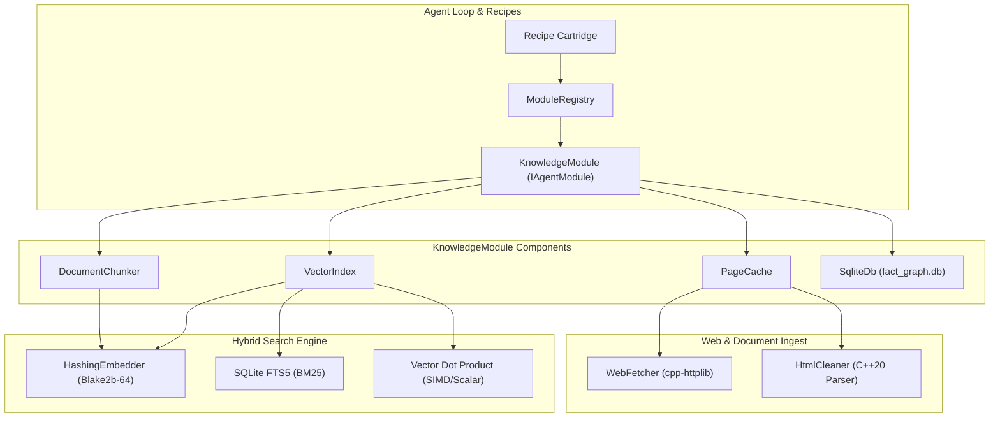
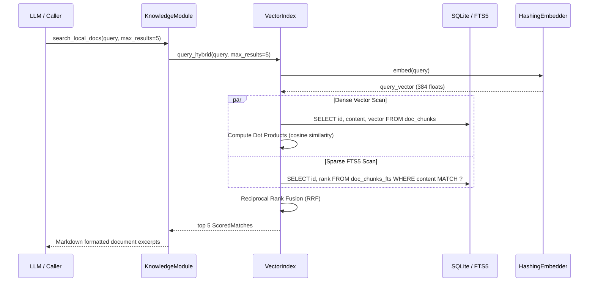

# Design Document: M6 — KnowledgeModule

## Overview & Architecture

Milestone M6 introduces the third core agent module, **`KnowledgeModule`**, providing persistent structured storage, hybrid semantic/lexical document search, a deterministic offline embedding engine, and a zero-I/O page cache.



---

## 1. Storage Subsystem (`aquila::storage`)

### 1.1 `SqliteDb`, `SqliteStmt`, and `SqliteTx`

Headers: `src/core/include/aquila/storage/sqlite_db.hpp`
Sources: `src/core/storage/sqlite_db.cpp`

```cpp
namespace aquila::storage {

class SqliteError : public std::runtime_error {
public:
    SqliteError(int code, int extended_code, std::string message, std::string sql = "");
    int code() const noexcept;
    int extended_code() const noexcept;
    std::string_view sql() const noexcept;
};

class SqliteStmt;

class SqliteDb {
public:
    SqliteDb();
    ~SqliteDb();

    SqliteDb(const SqliteDb&) = delete;
    SqliteDb& operator=(const SqliteDb&) = delete;
    SqliteDb(SqliteDb&& other) noexcept;
    SqliteDb& operator=(SqliteDb&& other) noexcept;

    static SqliteDb open(const std::filesystem::path& path, int flags = 0);
    static SqliteDb open_memory();

    bool is_open() const noexcept;
    void close() noexcept;

    void execute(std::string_view sql);
    SqliteStmt prepare(std::string_view sql);

    int64_t last_insert_rowid() const noexcept;
    int changes() const noexcept;
    sqlite3* raw_handle() noexcept;

private:
    sqlite3* handle_{nullptr};
};

class SqliteStmt {
public:
    explicit SqliteStmt(sqlite3_stmt* stmt = nullptr, std::string sql = "");
    ~SqliteStmt();

    SqliteStmt(const SqliteStmt&) = delete;
    SqliteStmt& operator=(const SqliteStmt&) = delete;
    SqliteStmt(SqliteStmt&& other) noexcept;
    SqliteStmt& operator=(SqliteStmt&& other) noexcept;

    // Binding helpers (1-based index)
    SqliteStmt& bind(int index, int val);
    SqliteStmt& bind(int index, int64_t val);
    SqliteStmt& bind(int index, double val);
    SqliteStmt& bind(int index, std::string_view val);
    SqliteStmt& bind(int index, std::span<const uint8_t> blob);
    SqliteStmt& bind_null(int index);

    // Named binding helpers
    SqliteStmt& bind(const char* name, int val);
    SqliteStmt& bind(const char* name, int64_t val);
    SqliteStmt& bind(const char* name, double val);
    SqliteStmt& bind(const char* name, std::string_view val);
    SqliteStmt& bind(const char* name, std::span<const uint8_t> blob);
    SqliteStmt& bind_null(const char* name);

    // Execution
    bool step(); // true on SQLITE_ROW, false on SQLITE_DONE
    void reset();
    void clear_bindings();

    // Column accessors (0-based index)
    int column_int(int col) const;
    int64_t column_int64(int col) const;
    double column_double(int col) const;
    std::string_view column_text(int col) const;
    std::span<const uint8_t> column_blob(int col) const;
    bool is_null(int col) const;
    int column_count() const noexcept;

private:
    sqlite3_stmt* stmt_{nullptr};
    std::string sql_;
};

class SqliteTx {
public:
    explicit SqliteTx(SqliteDb& db, bool immediate = true);
    ~SqliteTx();

    SqliteTx(const SqliteTx&) = delete;
    SqliteTx& operator=(const SqliteTx&) = delete;
    SqliteTx(SqliteTx&& other) noexcept;
    SqliteTx& operator=(SqliteTx&& other) noexcept;

    void commit();
    void rollback();

private:
    SqliteDb* db_{nullptr};
    bool active_{false};
};

} // namespace aquila::storage
```

---

## 2. Embedding Engine (`aquila::knowledge`)

### 2.1 HashingEmbedder (Bit-Exact Python Parity)

Headers: `src/core/include/aquila/knowledge/embedding.hpp`
Sources: `src/core/knowledge/embedding.cpp`, `src/core/knowledge/blake2b.cpp`

Python's `HashingEmbeddingFunction` (`agent/storage/embeddings.py:226-300`) implements an offline, deterministic bag-of-words + char-ngram feature extraction mapped into a 384-dimensional unit vector using Blake2b-64:

$$\vec{v}_i = \sum_{t \in \text{tokens}(text)} \text{sign}(t) \cdot \mathbf{1}_{\{ \text{bucket}(t) = i \}}$$
$$\vec{u} = \frac{\vec{v}}{\|\vec{v}\|_2}$$

```cpp
namespace aquila::knowledge {

class IEmbeddingEngine {
public:
    virtual ~IEmbeddingEngine() = default;
    virtual std::vector<float> embed(std::string_view text) const = 0;
    virtual std::size_t dimension() const noexcept = 0;
};

class HashingEmbedder final : public IEmbeddingEngine {
public:
    explicit HashingEmbedder(std::size_t dim = 384);

    std::vector<float> embed(std::string_view text) const override;
    std::size_t dimension() const noexcept override { return dim_; }

private:
    std::size_t dim_{384};

    // RFC 7693 Blake2b-64 digest computation
    static void blake2b_64(const void* in, std::size_t inlen, uint8_t out[8]);
    void extract_tokens(std::string_view text, std::vector<std::string>& tokens) const;
};

} // namespace aquila::knowledge
```

---

## 3. Vector Storage & Hybrid Retrieval (`aquila::knowledge`)

Headers: `src/core/include/aquila/knowledge/vector_index.hpp`
Sources: `src/core/knowledge/vector_index.cpp`



```cpp
namespace aquila::knowledge {

struct ScoredMatch {
    std::string id;
    std::string collection;
    std::string content;
    nlohmann::json metadata;
    float score{0.0f};
};

class VectorIndex {
public:
    explicit VectorIndex(storage::SqliteDb& db, std::shared_ptr<IEmbeddingEngine> embedder);

    void init_tables();
    void upsert(const std::string& collection,
                const std::string& id,
                std::string_view content,
                const nlohmann::json& metadata);

    std::vector<ScoredMatch> search_dense(const std::string& collection,
                                          std::string_view query,
                                          std::size_t top_k,
                                          const std::optional<std::string>& filter_instance_id = std::nullopt);

    std::size_t count(const std::string& collection) const;

    // Migrate from Chroma SQLite database (chroma.sqlite3)
    std::size_t import_chroma_db(const std::filesystem::path& chroma_db_path);

private:
    storage::SqliteDb& db_;
    std::shared_ptr<IEmbeddingEngine> embedder_;
};

} // namespace aquila::knowledge
```

---

## 4. Web Fetcher, Cleaner & Page Cache (`aquila::knowledge`)

Headers: `src/core/include/aquila/knowledge/page_cache.hpp`
Sources: `src/core/knowledge/page_cache.cpp`, `src/core/knowledge/html_cleaner.cpp`

### 4.1 `HtmlCleaner`
A clean C++ state machine parsing HTML tags and extracting textual content while rejecting script/style boilerplate and noisy formatting:
- Strips: `<script>`, `<style>`, `<noscript>`, `<svg>`, `<nav>`, `<header>`, `<footer>`, `<aside>`, `<form>`, and `<!-- comments -->`.
- Converts block boundaries (`<p>`, `<div>`, `<h1>`-`<h6>`, `<li>`, `<tr>`) into clean linebreaks.
- Entity decoding for `&quot;`, `&amp;`, `&lt;`, `&gt;`, `&#39;`, `&nbsp;`, and numeric decimal/hex entities.

### 4.2 `PageCache`
Maintains `page_cache` table in SQLite:
```sql
CREATE TABLE IF NOT EXISTS page_cache (
    url_hash TEXT PRIMARY KEY,
    url TEXT NOT NULL,
    clean_text TEXT NOT NULL,
    title TEXT,
    content_hash TEXT NOT NULL,
    fetched_at DATETIME DEFAULT CURRENT_TIMESTAMP,
    status_code INTEGER NOT NULL
);
```

```cpp
namespace aquila::knowledge {

struct CleanedPage {
    std::string url;
    std::string clean_text;
    std::string title;
    int status_code{200};
    bool from_cache{false};
};

class PageCache {
public:
    explicit PageCache(storage::SqliteDb& db);

    void init_tables();
    CleanedPage fetch_and_clean(std::string_view url, bool bypass_cache = false);

private:
    storage::SqliteDb& db_;
    std::string canonicalize_url(std::string_view url) const;
    std::string compute_url_hash(std::string_view canonical_url) const;
};

} // namespace aquila::knowledge
```

---

## 5. Local Document Chunker (`aquila::knowledge`)

Headers: `src/core/include/aquila/knowledge/document_chunker.hpp`
Sources: `src/core/knowledge/document_chunker.cpp`

Markdown chunking parses headers and preserves hierarchical breadcrumbs:
- E.g. `# Module` -> `## Storage` -> `### SQLite` produces chunk tagged `Module > Storage > SQLite`.
- Sliding token window ensures chunks do not exceed `max_chunk_tokens` (default 512).
- Chunks indexed into SQLite table `doc_chunks` with `HashingEmbedder` vectors and FTS5 virtual table `doc_chunks_fts`.

---

## 6. KnowledgeModule (`aquila::knowledge::KnowledgeModule`)

Headers: `src/core/include/aquila/knowledge/knowledge_module.hpp`
Sources: `src/core/knowledge/knowledge_module.cpp`

Implements `IAgentModule` (`src/core/include/aquila/modules/module.hpp`):

```cpp
namespace aquila::knowledge {

class KnowledgeModule final : public modules::ModuleBase {
public:
    explicit KnowledgeModule(std::filesystem::path memory_dir = "");

    std::string_view get_id() const noexcept override { return "KnowledgeModule"; }
    void configure(const nlohmann::json& initial_state) override;

    std::vector<ActionSchema> get_actions() const override;
    ActionResult execute_action(const std::string& action_name, const nlohmann::json& args) override;

    nlohmann::json export_state_snapshot() const override;
    void restore_state_snapshot(const nlohmann::json& snapshot) override;

    // Direct C++ API for hooks / other modules
    storage::SqliteDb& db() noexcept { return db_; }
    VectorIndex& vector_index() noexcept { return *vector_index_; }
    PageCache& page_cache() noexcept { return *page_cache_; }

private:
    std::filesystem::path storage_dir_;
    storage::SqliteDb db_;
    std::shared_ptr<IEmbeddingEngine> embedder_;
    std::unique_ptr<VectorIndex> vector_index_;
    std::unique_ptr<PageCache> page_cache_;
    std::unique_ptr<DocumentChunker> chunker_;

    // Context snapshot memory
    std::vector<std::string> recent_queries_;
    std::vector<std::string> accessed_urls_;

    ActionResult act_search_local_docs(const nlohmann::json& args);
    ActionResult act_fetch_and_clean_url(const nlohmann::json& args);
    ActionResult act_store_fact(const nlohmann::json& args);
    ActionResult act_recall_experiences(const nlohmann::json& args);
    ActionResult act_get_all_facts(const nlohmann::json& args);
};

} // namespace aquila::knowledge
```

---

## 7. Python Counterpart & R19 / R20 Dispositions

| Feature | Python Reference (`759212a`) | C++ M6 Implementation | Verdict (R19/R20) |
|---|---|---|---|
| Facts Storage | SQLite `facts` table (`memory.py:258`) | `SqliteDb` RAII over `fact_graph.db` | **Identical schema, memory-safe RAII** |
| Scratchpad Notes | SQLite `scratchpad` (`memory.py:269`) | `SqliteDb` RAII over `fact_graph.db` | **Identical schema, memory-safe RAII** |
| Vector Engine | ChromaDB (`chromadb.PersistentClient`) | In-tree `VectorIndex` with SQLite vector blobs + SIMD dot product | **Replaced.** Eliminates huge Chroma Python dependencies and native DLL locks (H10) |
| Embedding Function | `HashingEmbeddingFunction` / MiniLM ONNX | Native `HashingEmbedder` (Blake2b-64) | **Exact Parity.** Bit-for-bit mathematical match to Python's hashing embedder |
| Web Scraping | `web_tools.py` (SearXNG + cloudscraper/BS4/markdownify) | `WebFetcher` (cpp-httplib) + native `HtmlCleaner` | **Improved.** No external BeautifulSoup / cloudscraper; fast native C++ cleaner |
| Page Cache | None (network hit on every call) | SQLite `page_cache` table | **New.** Repeated URL lookups cost 0 network I/O (R11) |
| Doc Chunking | Ad-hoc line chunking | Structural markdown header tree chunking + FTS5 BM25 | **Improved.** Hierarchical breadcrumbs + hybrid dense/sparse retrieval |
| Episodic Memory | Chroma `episodic_experiences` collection | `vector_entries` with Chroma import tool | **Preserved & Migrated.** Existing `vector_db/chroma.sqlite3` readable directly (H11) |

---

## 8. Failure Modes & Error Vocabulary

| Error Code | Trigger Condition | Handling / Recovery |
|---|---|---|
| `db_error` | SQLite syntax error, corruption, or constraint failure | Converted from `SqliteError`, logged with query and error code |
| `db_locked` | SQLite busy timeout exceeded (5000ms) | Returns typed error, unlocks connection |
| `invalid_url` | URL missing scheme or hostname | Validation failure, prompt hints correct URL syntax |
| `fetch_timeout` | HTTP connection or read timed out (>10s) | Returns typed error; suggestions provided |
| `fetch_failed` | Non-200 HTTP status (e.g. 404, 403, 500) | Formats status code and brief response message |
| `page_too_large` | Response payload exceeds 2 MB limit | Truncated safely or rejected with error |
| `doc_not_found` | Search query returned 0 matches in local index | Honest empty result; hints broader keywords |
| `invalid_args` | Missing required fields or wrong JSON types | Enforced by `ModuleBase` schema check |

