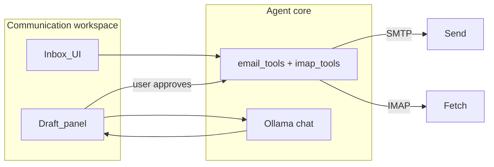

# Communication workspace vision (Aquila 4.0+)

**Status:** Draft — planning document only.

**User-facing name:** **Communication** (new major sidebar workspace — email first; other channels later).

## Goal

A **smart inbox** where Aquila helps read, draft, and (with explicit guardrails) send email — using local LLM reasoning and existing SMTP tooling.

**Past 4.0 (explicit deferral):** Discord, Instagram, Messenger, and other chat/social APIs — separate connectors, likely **`aquila[comms]`** or per-provider extras once email MVP is stable.

## Existing foundation (3.5 codebase)

| Asset | Location | Notes |
|-------|----------|-------|
| SMTP send | `agent/tool_library/email_tools.py`, Settings → Email | Outbound only today |
| `send_email` tool | Task / loop palettes | Requires `.env` SMTP |
| Settings email page | `settings_page.py` | SMTP credentials |

**Gap:** no **IMAP/inbox read**, no GUI inbox, no draft-review flow.

## Design principles

1. **Draft-first, send-explicit** — 4.0 MVP: Aquila proposes drafts; user approves before send. Autonomous send only with clear rules (see below).
2. **Same brain** — inbox actions use Chat/Task tools or a dedicated Communication agent surface; no separate cloud LLM.
3. **Credentials in data root** — OAuth tokens and app passwords under `Agent-Instances/`, encrypted at rest TBD; never in Git.
4. **Optional extra** — consider `pip install aquila[comms]` for IMAP/OAuth deps so core install stays lean ([roadmap-4.0.md](roadmap-4.0.md) Pillar E).

## 4.0 MVP scope (4.0f — proposed)

| Feature | In MVP? |
|---------|---------|
| IMAP inbox read (one account) | Yes |
| Thread list + message view in GUI | Yes |
| “Draft reply” / “Draft new” with Aquila | Yes |
| User clicks **Send** after review | Yes |
| Autonomous send from subject-only prompt | **Limited** — requires user-enabled rule + confirmation log |
| Gmail OAuth | Stretch; IMAP + app password first |
| Discord / Insta / Messenger | **No** — 4.x+ |

### Autonomous send (guardrails)

If we ship “send for me based on subject + context” in 4.0 at all:

- **Off by default** (`AQUILA_EMAIL_AUTOSEND=0`)
- Requires per-rule allowlist (domains, labels, max sends/day)
- Every send logged to `Agent-Logs/email/`
- Optional “always show draft before send” override

Full unattended autoresponder behavior is **4.x**, not day-one 4.0f.

## Architecture (target)

## MVP checklist (4.0f)

- [ ] IMAP read + local cache index (headers, thread id, snippet)
- [ ] Communication sidebar: inbox list, message detail, compose
- [ ] “Help me draft” → Chat subcall with thread context
- [ ] Send via existing SMTP after user confirm
- [ ] Settings: IMAP + SMTP account (can share credentials pattern with 3.5 Email page)

## Stretch (4.x+)

- [ ] Gmail / Outlook OAuth connectors
- [ ] Multiple accounts
- [ ] Autonomous send rules engine
- [ ] Discord bot / webhook read (separate design doc)
- [ ] Voice: “Read my unread emails” / “Draft a reply to …”

## Non-goals (4.0)

- Unified social DM inbox (Insta/Messenger/Discord)
- Replacing Gmail/Outlook mobile apps
- Email as default notification transport for Aquila tasks (could revisit with smart home)

## See also

- [roadmap-4.0.md](roadmap-4.0.md)
- [voice-interface-vision.md](voice-interface-vision.md)
