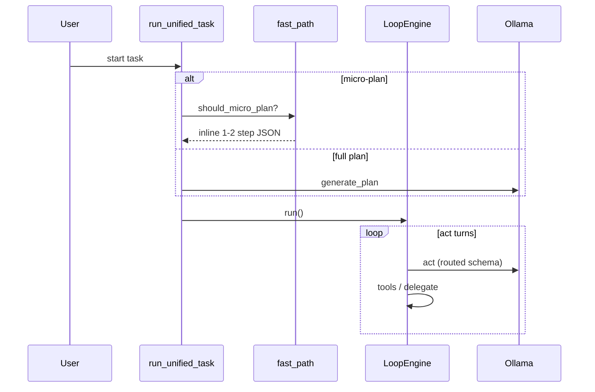
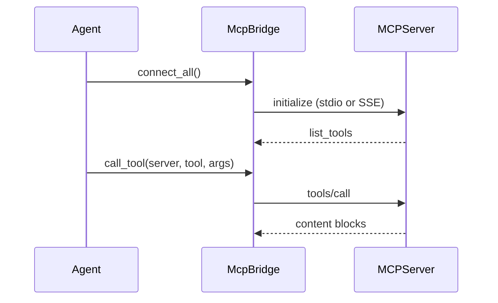
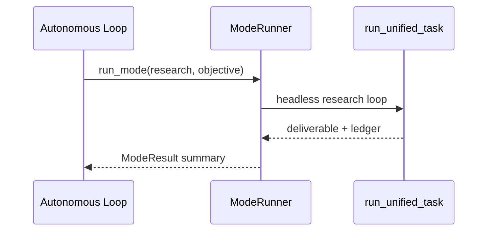
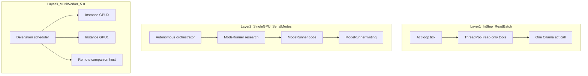

# Loop Rework and Parallelism (3.5 → 5.0)

Authoritative reference for the loop speed rework, MCP integration, ModeRunner delegation, and the 5.0 parallelism roadmap.

---

## Part I — What was implemented

### Executive summary

**Problem:** Task loops (code, research, writing) felt slow because each run paid for explore brief + full LLM plan generation + many act turns with large prompts.

**Constraints:** Single local Ollama client per agent instance; one GPU; local-first data.

**Outcomes:**

- Simple objectives can use a **micro-plan** (no planner LLM call).
- **MCP tools** extend capability without growing every mode’s schema.
- **Autonomous 4.0** can delegate to Research/Code/Writing via `ModeRunner` and `step_kind: delegate`.
- **5.0 parallelism** is specified but not implemented (see Part II).



---

### MCP bridge

| Item | Detail |
|------|--------|
| Module | [`agent/core/mcp_bridge.py`](../agent/core/mcp_bridge.py) |
| Transports | **stdio** (subprocess) and **SSE** (HTTP URL) |
| Tool prefix | `mcp__{server}__{tool}` |
| Lifecycle | `connect_all()` on agent init; `disconnect_all()` on refresh/shutdown |
| Config | `Agent-Instances/app_settings.json` → `mcp_servers`; optional per-instance in `profile.json` |



**Touch these files:** `mcp_bridge.py`, `runtime_settings.py`, `main.py`, `loop_engine.py`, `settings_page.py`, `remote/server.py`

User guide: [mcp-integration.md](mcp-integration.md)

---

### Micro-plan fast path

| Item | Detail |
|------|--------|
| Module | [`agent/core/fast_path.py`](../agent/core/fast_path.py) |
| Trigger | Short request, no attachments, no complexity keywords, mode in code/writing/research/task |
| Output | 1–2 step ledger JSON with `"micro_plan": true` |
| Explore brief | Skipped when micro-plan used; otherwise gated by `AQUILA_EXPLORE_BRIEF` + complexity heuristics |

**Env vars:**

| Variable | Default | Meaning |
|----------|---------|---------|
| `AQUILA_FAST_PATH` | `1` | Enable micro-plan classifier |
| `AQUILA_MICRO_PLAN_MAX_WORDS` | `80` | Max words for micro-plan |
| `AQUILA_EXPLORE_BRIEF` | `0` | Explore brief off unless `1` + complex request |

**Touch these files:** `fast_path.py`, `main.py` (`run_unified_task`), `plan_validator.py` (`micro` step kind)

---

### Loop slimming

| Feature | Implementation |
|---------|----------------|
| Routed schema | Existing `_schema_for_step`; MCP tools added when mode allows |
| Compact micro steps | `step_kind: micro` uses smaller default budgets |
| Read-only batching | `_execute_reads_parallel` + `AQUILA_READ_BATCH=1` |
| Act streaming | `AQUILA_ACT_STREAM=1` when GUI `ui_callback` present |
| Scorecard metrics | `micro_plan_used`, `explore_brief_skipped`, `act_turn`, `plan_llm_call`, `delegate_mode_complete` |

**Touch these files:** `loop_engine.py`, `capability_scorecard.py`, `run_logger.py` events

Regression: `scripts/aquila-capability-run.sh` (pytest, matrix, replay). Harness playbook: [aquila-recursive-harness.md](aquila-recursive-harness.md).

---

### ModeRunner

| Item | Detail |
|------|--------|
| Module | [`agent/core/mode_runner.py`](../agent/core/mode_runner.py) |
| Contract | `ModeResult`: status, mode, summary, deliverable_path, ledger_path, metrics |
| Nested ledgers | `Agent-Tasks/{parent}/delegations/{mode_ts}.json` |
| Artifacts | `Agent-Tasks/{parent}/artifacts/{id}.mode_result.json` |



**Touch these files:** `mode_runner.py`, `main.py`, `remote/tasks.py` (via `run_unified_task`)

---

### Autonomous delegation

| Mechanism | Behavior |
|-----------|----------|
| `step_kind: delegate` | OS auto-runs `ModeRunner` on step entry (no extra LLM turn) |
| Step fields | `target_mode`, `delegate_objective`, optional `context` |
| `delegate_mode` tool | Manual delegation from act loop in task/autonomous mode |
| Mode stack UI | [`task_page.py`](../agent/gui/gui_pages/task_page.py) lists `load_delegation_stack()` |

**Touch these files:** `loop_engine.py`, `delegation_tools.py`, `tool_catalog.py`, `plan_validator.py`, `task_page.py`

---

### Migration notes

| Change | Opt out |
|--------|---------|
| Explore brief default off | `AQUILA_EXPLORE_BRIEF=1` |
| Micro-plan on by default | `AQUILA_FAST_PATH=0` |
| Act streaming in GUI | `AQUILA_ACT_STREAM=0` |
| Read batching | `AQUILA_READ_BATCH=0` |

Complex jobs still use full `generate_plan` when heuristics reject micro-plan.

---

### Environment reference (Phases 0–3)

| Variable | Default | Phase |
|----------|---------|-------|
| `AQUILA_MCP_ALLOWED_MODES` | autonomous,task,research,code,writing | MCP |
| `AQUILA_FAST_PATH` | 1 | Fast path |
| `AQUILA_MICRO_PLAN_MAX_WORDS` | 80 | Fast path |
| `AQUILA_EXPLORE_BRIEF` | 0 | Fast path |
| `AQUILA_ACT_STREAM` | 1 | Loop slim |
| `AQUILA_READ_BATCH` | 1 | Loop slim |
| `AQUILA_ROUTE_TOOLS` | 1 | Existing |

---

## Part II — Full 5.0 parallelism plan (future)

**4.0 does not** run multiple mode loops in parallel on one GPU. **5.0 will** schedule independent delegations across workers.

### Parallelism layers



| Layer | Parallelism | Shipped |
|-------|-------------|---------|
| L1 In-step read batch | read_file, list_directory, grep in one turn | **3.5** |
| L2 Serial mode delegation | One mode at a time, artifact handoff | **4.0** |
| L2b Cursor parallel lane | Cursor edits locally; Aquila MCP host runs Ollama via 6 meta-tools | **4.0** |
| L3 Multi-worker | Independent branches on separate GPUs/hosts | **5.0** |

### L3 components (design)

1. **Worker registry** — Map `instance_id` → `{ollama_base_url, gpu_id, max_concurrent, busy}`. Remote hosts register via existing [`agent/remote/`](../agent/remote/).

2. **Delegation scheduler** — Input: plan DAG with `depends_on`. Output: assign `delegate_mode` jobs to idle workers. Rule: one active generation per `ollama_base_url` unless VRAM policy allows more.

3. **Artifact bus** — Handoffs under `Agent-Tasks/{parent}/artifacts/` (deliverables, summaries, MCP blobs). Parent reads `ModeResult` JSON, not child conversation history.

   **4.0 scratchpad handoff (planned):** Today, research scratchpad rows are keyed by `instance_id::task_id` via [`agent/task_context.py`](../agent/task_context.py) — the model cannot supply a different `task_name` on `save_research_note` / `read_all_research_notes` (OS injects the active ledger id). In 4.0 autonomous delegation, the parent loop will pass forward:

   - SQLite scratchpad export for the child `task_id` (or merged notes markdown)
   - `ModeResult.deliverable_path` and workspace step summaries
   - Parent `artifact bus` manifest linking child task id → files

   Child modes start with `set_active_task_id(child_task_id)` so notes never leak across delegations. See also [`docs/aquila-recursive-harness.md`](aquila-recursive-harness.md).

4. **Conflict policy** — One writer per workspace root; serialize code+research on same tree or partition paths.

5. **Checkpoint / resume** — Snapshot parent ledger + child `ModeResult` chain + scheduler queue; resume failed nodes only.

6. **Batch queue** — Independent top-level tasks when workers > 1; compatibility grouping (research + writing OK in parallel; two code jobs on same tree not OK).

7. **MCP under parallelism** — MCP subprocesses are **per worker instance**; no shared MCP across workers.

8. **Failure modes** — Worker timeout, Ollama OOM → retry with backoff; fallback to serial on single GPU.

9. **Metrics** — Per delegation: wall time, LLM calls, worker id, queue wait; surface in task mode stack (5.0 UI).

10. **Rollout**
    - **5.0a** — Two local instances, manual worker pick
    - **5.0b** — DAG scheduler + artifact bus
    - **5.0c** — Remote worker pool + batch queue

### What 4.0 explicitly does not do

- `asyncio.gather` across modes on one GPU
- Parallel `run_unified_task` on one `OllamaClient`
- Cross-worker ledger sharing without artifact files

---

## Capability scorecard baseline

After implementation, compare runs with:

```bash
cd agent
pytest tests/test_capability_scorecard.py -q
# Live regression (requires Ollama):
# ../scripts/aquila-capability-run.ps1
```

Track: `llm_requests`, `act_turns`, `plan_llm_calls`, `micro_plan_used`, wall time.

---

## Dynamic loop (milestone-driven work)

When `AQUILA_DYNAMIC_LOOP=1`, the act loop uses mode-wide tool palettes, task episode budgets, and milestone-based advance/finish instead of rigid search→read→synthesize pipelines. See [loop-dynamic.md](loop-dynamic.md).

| Env | Default | Role |
|-----|---------|------|
| `AQUILA_DYNAMIC_LOOP` | `0` | Enable dynamic palette + milestones |
| `AQUILA_AUTO_ADVANCE_MILESTONES` | `1` | Auto `mark_objective_complete` when step milestones met |
| `AQUILA_TASK_EPISODE_MAX` | `32` | Hard cap on toolful act turns per task |
| `AQUILA_TASK_WEB_SEARCH_CAP` | `12` | Max `web_search` per task (anti-spiral) |

---

## Related docs

- [loop-dynamic.md](loop-dynamic.md)
- [mcp-integration.md](mcp-integration.md)
- [ARCHITECTURE.md](../ARCHITECTURE.md) §18b, §21
- [runtime-settings.md](runtime-settings.md)
