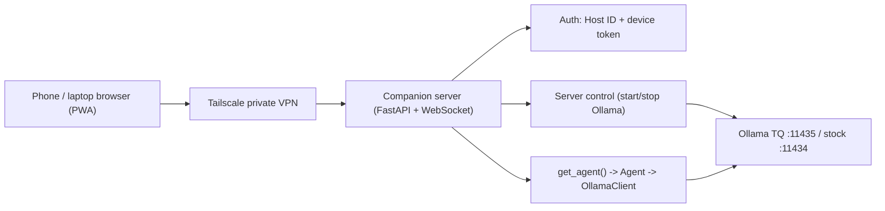

# Aquila Remote Companion

Use Aquila from an iPhone, Android phone, Mac, or Windows laptop by talking to
your host PC over a private [Tailscale](https://tailscale.com) network. The host
runs a small web server that reuses Aquila's existing brain and streams
responses to an installable web app (PWA). No port forwarding, no app store.



Two security layers:

1. **Tailscale** — only devices on your private mesh can reach the machine.
2. **Host ID + device token** — even an open-source copy of the app cannot
   connect to your host without a pairing code generated on your machine.

---

## 1. Prerequisites

- Python deps: `pip install -r requirements.txt` (adds `fastapi`, `uvicorn`,
  `websockets`).
- **Windows hosts:** install [Git for Windows](https://git-scm.com/download/win)
  so `bash` (Git Bash) is available — the Ollama serve scripts and the launcher
  are cross-platform bash `.sh` files. macOS/Linux already have bash.
- An Ollama engine you can start (stock on `:11434` and/or TurboQuant on
  `:11435`). See [ollama-dual-setup.md](ollama-dual-setup.md).

## 2. Install Tailscale

Install Tailscale on the **host** and on **each device** and sign them into the
same account (tailnet):

- Host (Windows/macOS/Linux) and laptops: <https://tailscale.com/download>
- iPhone: App Store → "Tailscale". Android: Play Store → "Tailscale".

After signing in, each machine gets a stable `100.x.y.z` address. Find the
host's address in the Tailscale app (or `tailscale ip -4`). That address only
works for your own devices.

## 3. Start the companion server (host)

From the repo root, in Git Bash (Windows) or a terminal (macOS/Linux):

```bash
./scripts/aquila-remote-serve.sh
# or bind explicitly to the Tailscale IP:
./scripts/aquila-remote-serve.sh --host 100.x.y.z --port 8800
```

The script prints your **Host ID** and a fresh **pairing code**, then serves the
app on port `8800`.

## 4. Pair a device (once per device)

1. On a device, open `http://<host-tailscale-ip>:8800` in the browser.
2. Enter the **Host ID** and the **pairing code** shown by the launcher, plus a
   device name, and tap **Pair**.
3. The browser stores a long-lived device token. You can now **Add to Home
   Screen** (iOS Share → Add to Home Screen; Android/Chrome → Install) to run it
   like a native app.

Need another code later? On the host run:

```bash
cd agent
python -m remote.host_cli pair-code      # mint a new one-time code
python -m remote.host_cli devices        # list paired devices
python -m remote.host_cli revoke <id>    # revoke a lost device
```

## 5. Use it

The app has a workspace switcher (bottom bar on phones, left sidebar on desktop):

- **Chat** — pick an instance, type, watch streamed answers and a collapsible
  **Thinking** pane. Toggle **Light research** to add one web-search pass.
  **Attach** files (PDF/DOCX/images/text) as one-shot context for a message.
  Final answers render Markdown and pretty-printed JSON.
- **Character** — browse persona cards, create a persona (name/description +
  optional source files + a "web research for lore" toggle) and watch it build
  live, then open a persona to roleplay. History is saved on the host.
- **Learn** — two sub-tabs:
  - **Courses** — create a course (title/topic/intake + source files + web
    toggle) and watch the syllabus build, then open it for the syllabus tree, a
    node-aware **tutor chat**, and basic **assessments** (read questions, submit
    a self-graded score to advance mastery).
  - **Archives** — create an archive, upload + index source documents, and chat
    against them (ask it to draft a study doc or quiz).
- **Research** — enter a question (+ an optional journal note + attachments),
  launch a job, and watch the live **ledger** and **plan steps**. When it
  finishes, read the rendered deliverable and **Download** it. Past deliverables
  are listed for re-reading.
- **Servers** — start/stop the **TurboQuant** (`:11435`) and **Stock**
  (`:11434`) Ollama engines, warm up or eject models, pick an **aquila model**,
  and **Use for chat** to retarget the shared agent client. **SearXNG** start/stop
  and health check live here too. See [runtime-settings.md](runtime-settings.md).

File attachments: the **Attach** button uploads files to `POST /api/uploads`,
which parses them once and returns a short-lived `upload_token` sent with your
next message or task. Course/archive sources are uploaded separately and indexed
for retrieval.

---

## How it works

The host server lives in [`agent/remote/`](../agent/remote/):

| Module | Responsibility |
|--------|----------------|
| `server.py` | FastAPI app: serves the PWA + JSON/WebSocket API |
| `session.py` | Bridges the blocking chat generator to async WebSocket frames |
| `auth.py` | Host ID, pairing codes, device-token issue/verify/revoke |
| `config.py` | Reads/writes `Agent-Instances/remote_config.json` |
| `server_control.py` | Starts/stops the Ollama `.sh` scripts via bash; single-engine enforcement; captured logs; status probes |
| `session.py` | Generalized chat dispatch (`chat`/`character`/`learn_tutor`/`learn_archive`) with server-authoritative history |
| `tasks.py` | Job-style runner wrapping `run_unified_task` → ledger/plan/done frames over `WS /api/task` |
| `uploads.py` | Parses uploaded files once → `(text_chunks, image_payloads)` cached under an `upload_token` |
| `personas.py` | Character persona REST helpers + persona-build wiring |
| `learn.py` | Course/archive REST helpers, source indexing, assessment submit |
| `host_cli.py` | Host-side CLI (`host-id`, `pair-code`, `devices`, `revoke`) |

The PWA is plain HTML/CSS/JS in [`webapp/`](../webapp/) (no build step) and is
installable via `manifest.webmanifest` + `service-worker.js`. It is split into
`app.js` (core, chat, servers, reusable chat/task clients), `markdown.js`
(Markdown + JSON renderer), and one module per workspace (`character.js`,
`learn.js`, `research.js`).

### Endpoints

| Method | Path | Auth | Purpose |
|--------|------|------|---------|
| GET | `/api/health` | none | Liveness + Host ID |
| POST | `/api/pair` | code | Exchange Host ID + pairing code for a device token |
| GET | `/api/instances` | token | List Aquila instances |
| POST | `/api/uploads` | token | Upload files → `upload_token` (multipart) |
| WS | `/api/chat?token=…` | token | Stream a chat/character/learn turn (`mode` field) |
| WS | `/api/task?token=…` | token | Run a research/build job → ledger/plan/done frames |
| GET | `/api/deliverable?path=` | token | Read a deliverable (whitelisted folders) |
| GET | `/api/research/deliverables` | token | List `Agent-Research/*.md` deliverables |
| GET | `/api/character/personas` (+ POST/DELETE) | token | Persona list/create(build)/delete |
| GET | `/api/character/personas/{id}/history` \| `/preferences` (GET/PUT) | token | Persona history + prefs |
| GET | `/api/learn/courses` (+ POST/DELETE) | token | Course list/create(build)/delete |
| GET | `/api/learn/courses/{id}/syllabus` \| `/tutor-history` \| `/assessments` | token | Course detail reads |
| POST | `/api/learn/courses/{id}/assessments/submit` \| `/sources` | token | Submit score / upload+index sources |
| GET | `/api/learn/archives` (+ POST/DELETE), `/{id}/history`, `/{id}/sources` | token | Archive CRUD + chat history + sources |
| GET | `/api/server/status` | token | Engine up/down + loaded models |
| POST | `/api/server/start` (`stop_other`) \| `/stop` | token | Start/stop an engine (`tq`/`stock`) |
| GET | `/api/server/logs?engine=&lines=` | token | Tail captured engine logs |
| POST | `/api/model/warmup` \| `/eject` | token | Warm up / eject models |
| GET \| PUT | `/api/runtime/settings` | token | Read/update active Ollama + SearXNG config |
| GET | `/api/ollama/models?engine=` | token | List aquila-tagged models for an engine |
| POST | `/api/ollama/active` | token | Set active engine + model for chat/tasks |
| GET | `/api/search/status` | token | SearXNG health + Docker status |
| POST | `/api/search/start` \| `/stop` | token | Start/stop `aquila-search` container |
| GET | `/api/devices`, DELETE `/api/devices/{id}` | token | List / revoke devices |

Chat-style turns over `WS /api/chat` carry a `mode` (`chat`, `character`,
`learn_tutor`, `learn_archive`) plus the matching id (`persona_id`,
`course_id`+`node_id`, or `archive_id`) and optional `upload_tokens`. For
character/learn the **server owns history** — it loads prior turns, runs the
brain, and saves the new turn via the registries.

## Security notes

- Keep the server bound to your Tailscale interface (or rely on Tailscale +
  firewall). Do **not** port-forward `8800` to the public internet.
- Device tokens are stored only as SHA-256 hashes in `remote_config.json`; the
  raw token is shown once at pairing and lives in the device's `localStorage`.
- Revoke lost devices with `python -m remote.host_cli revoke <token_id>`.
- For a trusted, single-user LAN you can set `AQUILA_REMOTE_NO_AUTH=1` to skip
  app-layer tokens (Tailscale still gates access). Not recommended if you share
  the tailnet.

## Concurrency

All instances share one `OllamaClient`, so the server **serializes** generation
with a single lock — one generation at a time across all devices and across both
chat and task jobs. A second task launched while one is running is rejected with
a `{"type":"busy"}` frame. Multi-session concurrency would need per-session
clients and is intentionally out of scope.

## Out of scope (for now)

- Writing canvas editing, Code IDE (file tree/patches), and Autonomous task mode
  in the browser. The `WS /api/task` runner is generic, so these are mostly UI
  work to add later.
- Native iOS/Android apps and app-store distribution.
- Concurrent multi-user generation on one host.
