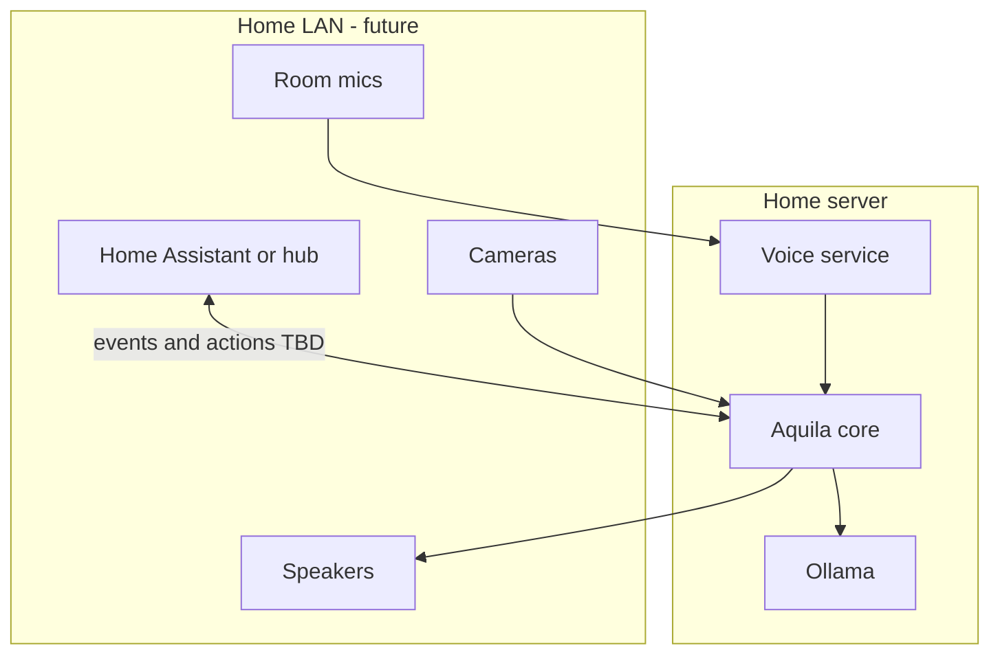

# Smart home vision (future — documentation only)

**Status:** Vision / architecture sketch only. **No implementation in Aquila 4.0.**

Hardware, room layout, and automation preferences are expected to change over the next year. This doc captures direction so 4.0 voice and ML Lab do not paint us into a corner — without committing to Home Assistant entities, MQTT topics, or webhook handlers yet.

## Goal (long-term)

A **local-first, open-source AI stack** on a home server where:

- **Aquila** handles natural language, multi-step reasoning, research, and ML jobs
- **Home Assistant** (or similar) handles device state, schedules, and low-latency automations
- **Tailscale** (or LAN) provides secure phone/laptop access (Remote Companion today)

Aquila is the **brain**; the automation hub remains the **nervous system** for devices.

## Why defer code

- Physical hardware (mics, speakers, satellites) not deployed yet
- Integration patterns (MQTT vs REST vs HA Conversation) need real-world iteration
- 4.0 should ship **voice + ML Lab + orchestration** first; home hooks add coupling prematurely

## Conceptual architecture (future)

## Plausible integration patterns (TBD)

| Pattern | Role | Notes |
|---------|------|-------|
| **HA Conversation / Assist** | Route some utterances to Aquila | Requires stable voice API |
| **MQTT** | Fire-and-forget events (“motion”, “low temp”) | Aquila subscribes; publishes actions cautiously |
| **REST webhooks** | Task triggers from automations | Simpler than full HA component |
| **Tailscale** | Remote phone access | Already used by Remote Companion |

None of these are committed for 4.0.

## What 4.0 should enable without home code

- Voice service API stable enough for a future HA custom component to call
- Headless `run_unified_task` + status endpoints (Remote Companion pattern)
- Perception tools returning structured JSON (camera frame → label)
- Generation lock so automations do not collide with GUI users

## Privacy defaults (carry forward)

- Wake phrase **toggle** — avoid accidental activation when discussing Aquila
- No cloud STT/TTS requirement
- Clear “listening” indicator on voice service
- User-controlled retention for voice logs (if any)

## When to revisit

- Dedicated hardware procured and installed
- Voice MVP (4.0d) stable in daily use
- At least one concrete automation user story (“announce when research finishes”, “read sensor summary”)

Then open a **4.x or 5.x** implementation plan — possibly a thin `aquila[home]` extra.

## See also

- [roadmap-4.0.md](roadmap-4.0.md)
- [voice-interface-vision.md](voice-interface-vision.md)
- [remote-companion.md](remote-companion.md)
