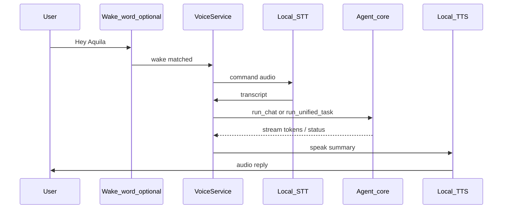

# Voice interface vision (Aquila 4.0)

**Status:** Draft — planning document only.

**Install:** `pip install aquila[voice]` — not required for core Aquila.

## Goal

Operate Aquila **entirely by voice**: start tasks, ask questions, hear progress, cancel work, and receive summaries — without opening the PySide6 GUI or Remote PWA. Primary step toward hands-free and future home-server use ([smart-home-vision.md](smart-home-vision.md) — vision only for now).

## Principles

1. **Same brain** — voice is a transport layer; `LoopEngine`, ledgers, and tools are unchanged.
2. **Local-first** — STT and TTS on the host; no mandatory cloud APIs.
3. **Explicit consent** — mic active only after wake phrase (if enabled) or push-to-talk.
4. **Serial GPU use** — STT/TTS prefer CPU; Ollama keeps the generation lock during LLM turns.

## Wake phrase (decided)

Ship **from voice MVP day one**, with a **user toggle** so Aquila is not always listening.

| Phrase family | Examples |
|---------------|----------|
| Direct | “Aquila”, “Aquila?” |
| Hailing | “Hey Aquila”, “OK Aquila” |

**Toggle behavior:**

- **Settings / `.env`:** `AQUILA_VOICE_WAKE_ENABLED=0|1` (exact name TBD at implementation).
- When **off**: no wake-word listener; use **push-to-talk** (or GUI/Remote only).
- When **on**: local wake-word detector runs; only after a match does STT capture the command utterance.
- Rationale: safe for development, demos, and conversations *about* Aquila without false triggers.

Push-to-talk remains available whenever wake is off (or as a parallel shortcut).

## Architecture (target)

### Components

| Component | Role | Candidate tech |
|-----------|------|----------------|
| **Wake detector** | Phrase match before STT | openWakeWord, Porcupine custom “Aquila” |
| **Voice service** | Daemon; session state; mode routing | Python service |
| **STT** | Speech → text | faster-whisper, whisper.cpp, Vosk |
| **TTS** | Text → speech | Piper, Coqui, OS fallback |
| **Intent router** | Mode + control verbs | Rules + optional LLM classify |

## MVP checklist (4.0d)

- [ ] `aquila[voice]` extra documented and installable
- [ ] Wake phrases (“Aquila”, “Hey Aquila”) with **toggle default off** (or clear UI to disable)
- [ ] Push-to-talk fallback
- [ ] Spoken cancel / status during `run_unified_task`
- [ ] STT/TTS config in Settings or `.env`
- [ ] Visual “listening” indicator (GUI optional mirror)

## Stretch (post-MVP)

- Custom wake sensitivity / phrase list in Settings
- Character AI voice personas
- Satellite mics (RPi → server WebSocket)
- Home Assistant media_player (after [smart-home-vision.md](smart-home-vision.md) implementation phase)

## Risks

| Risk | Mitigation |
|------|------------|
| False triggers when discussing Aquila | Wake toggle off by default or one-click off |
| GPU contention | CPU STT/TTS; generation lock |
| Latency | Stream TTS by sentence; brief ack first |

## See also

- [roadmap-4.0.md](roadmap-4.0.md)
- [remote-companion.md](remote-companion.md)
- [smart-home-vision.md](smart-home-vision.md)
